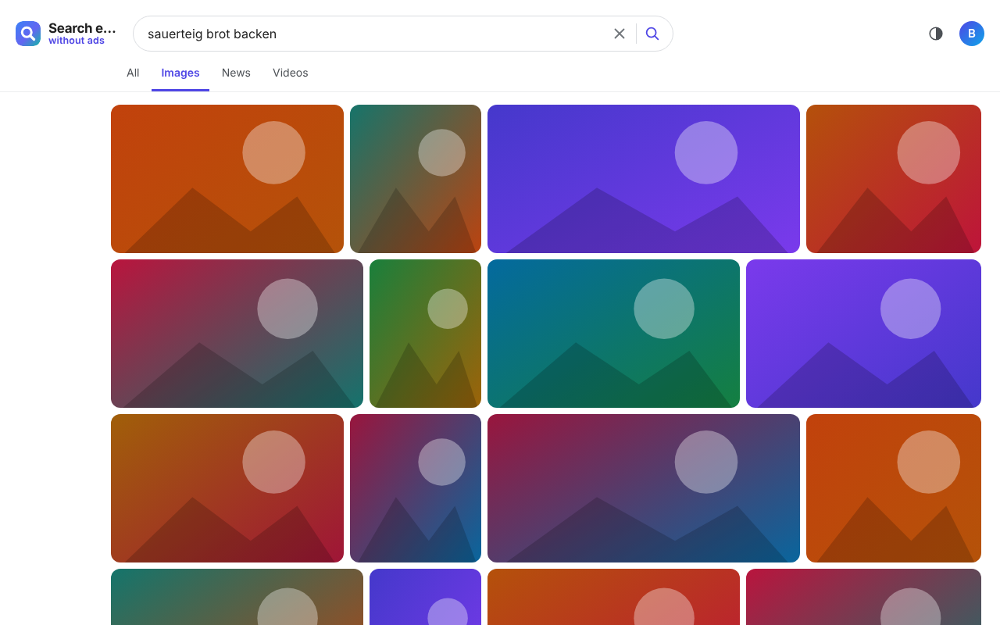
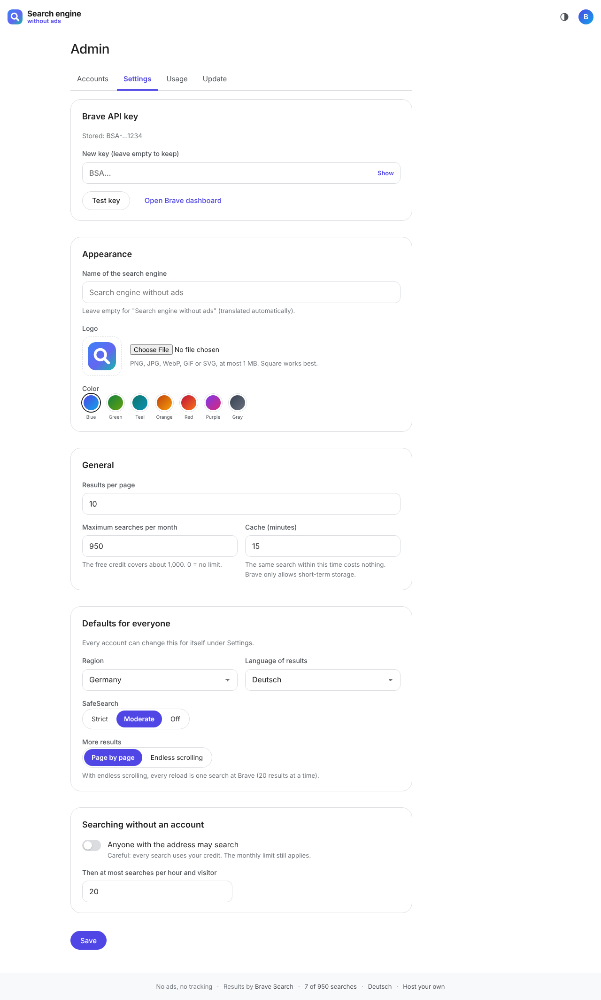

<p align="center"></p>

<h1 align="center">Search engine without ads</h1>

<p align="center"><b>Your own search engine. No ads, no tracking, on your own web space.</b><br>
Results by Brave Search, within the free monthly credit for normal private use.</p>

<p align="center"><a href="README.md">Deutsche Version</a> · <a href="../../releases/latest">Download the latest version</a></p>

<p align="center"></p>

Upload `suchmaschine-install.php`, open it in the browser, create your account, paste your Brave key. That is the whole installation.

The server runs PHP and SQLite, the browser plain JavaScript and CSS. No frameworks, no dependencies, no build step, no MySQL. Runs on ordinary shared hosting.

## Screenshots

<table>
  <tr>
    <td align="center"><br><sub>Home page</sub></td>
    <td align="center"><br><sub>Dark theme</sub></td>
  </tr>
  <tr>
    <td align="center"><br><sub>Image search</sub></td>
    <td align="center"><br><sub>Image preview</sub></td>
  </tr>
  <tr>
    <td align="center"><br><sub>News</sub></td>
    <td align="center"><br><sub>Videos</sub></td>
  </tr>
  <tr>
    <td align="center"><br><sub>Suggestions from your own recent searches</sub></td>
    <td align="center"><br><sub>Admin: key, name, logo, color</sub></td>
  </tr>
</table>

<p align="center">
  
  
  
</p>

## What does it cost?

Nothing for normal private use. Results come from the [Brave Search API](https://brave.com/search/api/):

- The **"Search"** plan includes **$5 of credit every month**. A search costs half a cent, so that covers **about 1,000 searches a month**.
- Brave asks for a **credit card** when you sign up, against abuse. Billing works with credit, no subscription. Keep **automatic top-up switched off** in the Brave dashboard and nothing is charged.
- The search engine has its own **monthly limit** (default 950). Once reached, it pauses until the first of the month, so you never go over the free credit by accident.
- A **cache** (default 15 minutes) makes reloading, the back button and paging free. Nothing is stored longer, because Brave's terms only allow short-term caching.

## Features

- **Web, images, news, videos** in tabs.
- **Mixed results** like the big search engines: top stories, videos, "People also ask" and forum discussions between the results, plus an **overview panel** (e.g. from Wikipedia).
- **Page by page or endless scrolling**, per account.
- **Time filter**, **spelling correction** with "Search instead for …", **"Feeling lucky"**.
- **Large image preview** with arrow keys.
- **Suggestions from your own recent searches**, stored only in the browser.
- **Light and dark**, automatic or by button. **German and English.**
- **Phone and desktop**, can be added to the home screen as an app.
- **Default search in your browser** via OpenSearch.
- **Accounts:** whoever signs up first becomes the administrator and can add more accounts, e.g. for the family. Every account has its own settings.
- **Admin page:** API key with test, name, **own logo**, **color**, defaults for everyone, monthly limit, usage per month, optional searching without an account (with an hourly limit).
- **One-click updates** from GitHub releases, verified by checksum, with one-click rollback. Optionally automatic once a day.
- **Self-test** that the internal folders are really blocked from outside.
- **No ads, no tracking, no third-party scripts.** Strict Content Security Policy, links open without referrer.

## Requirements

- Web space with **PHP 8.0 or newer** and the extensions `pdo_sqlite` and `curl`.
- Outgoing connections allowed (to `api.search.brave.com`, for updates to `github.com`).
- **HTTPS.**
- **Apache** (or LiteSpeed) blocks the internal folders by itself via `.htaccess`. **nginx** needs two lines in the configuration, see below.
- A **Brave Search API key** (free, see above).

## Installation

1. **Get a Brave key:** sign up at [api-dashboard.search.brave.com](https://api-dashboard.search.brave.com), choose the **"Search"** plan, add a card, **keep automatic top-up off**, create a key under **"API Keys"**.
2. Download **`suchmaschine-install.php`** from the [latest release](../../releases/latest) and copy it to a folder on your web space.
3. Open it in the browser **right away** and click **"Install now"**. It unpacks the program, deletes itself and redirects.
4. **Create your account** and **paste the Brave key** right afterwards. The key is checked with a test search. This account is the administrator.
5. **Test:** in Admin → *Update → Data protection* click "Check now". It must say "All tight".

On **Plesk** hosts (e.g. Netcup), nginx in front of Apache may serve files directly and skip `.htaccess`. Open the domain's **"Apache & nginx Settings"** and turn off **"Serve static files directly by nginx"** / **"Smart static files processing"**.

With your own nginx configuration, add this to the `server` block (adjust the path if installed in a subfolder):

```nginx
location ^~ /data/ { deny all; return 404; }
location ^~ /app/  { deny all; return 404; }
```

## Updating and backup

Admin → *Update* → "Check for updates" → "Update now". The running version is saved first and can be restored with one click. Or upload a new `suchmaschine-install.php` and open it: only program files are replaced, `data/` is never touched. Set `'update_url' => ''` in `data/config.php` to switch off update checks.

Everything that matters is in the folder **`data/`**: accounts, settings, API key, logo. Download that folder to back up.

## Good to know

- **Privacy:** Brave sees the search terms but not who searches, the request comes from your server. The search engine itself stores no search terms except briefly in the cache. Recent searches for suggestions stay in each device's browser.
- **Endless scrolling:** every reload is a real Brave search, so 20 results are fetched at a time. Brave delivers at most 10 pages per query.
- **Brave's terms:** results may only be cached briefly and not resold. A note about Brave Search is shown at the bottom of every page.

## Disclaimer

Free hobby software, provided **as is, without any warranty**. Use at your own risk. Whoever runs it is responsible for the server, its updates and backups, and for complying with Brave's terms. This project is not affiliated with Brave Software.

## License

GNU Affero General Public License v3.0, see [LICENSE](LICENSE).
