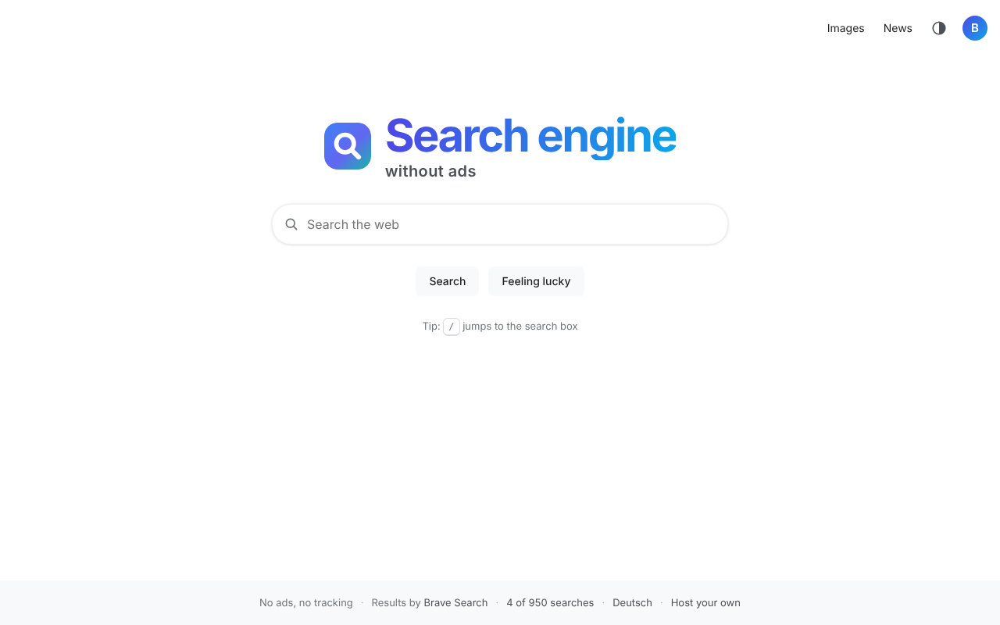
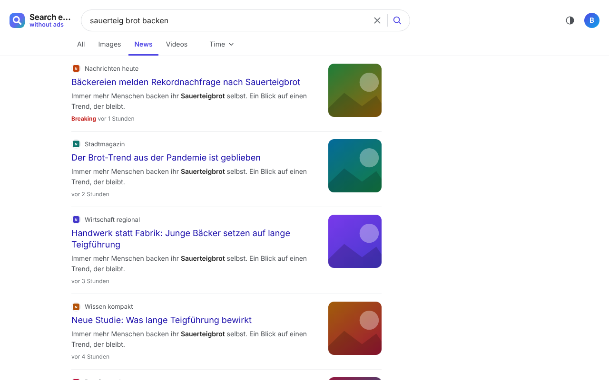
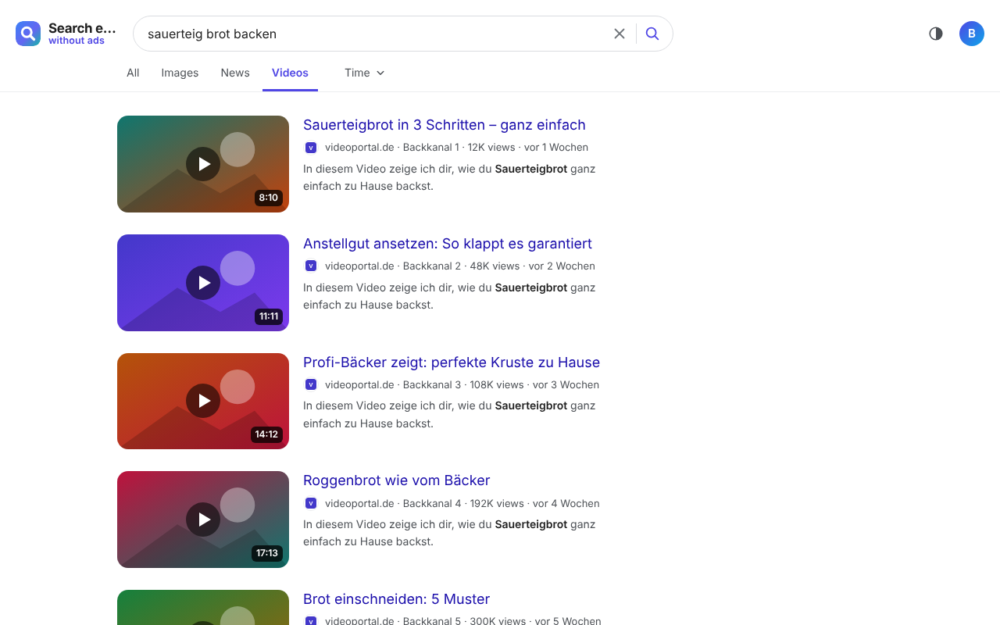
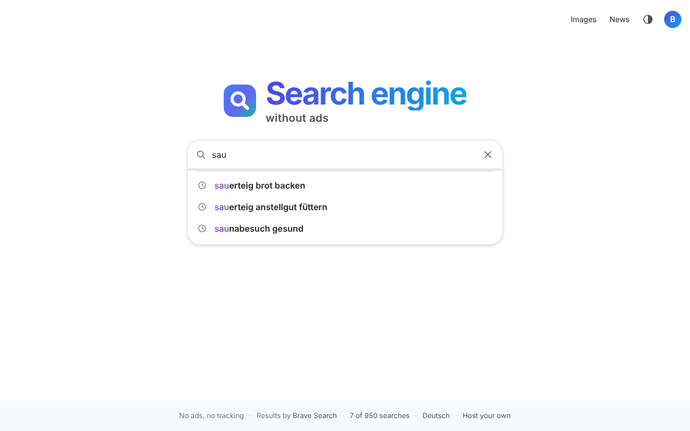
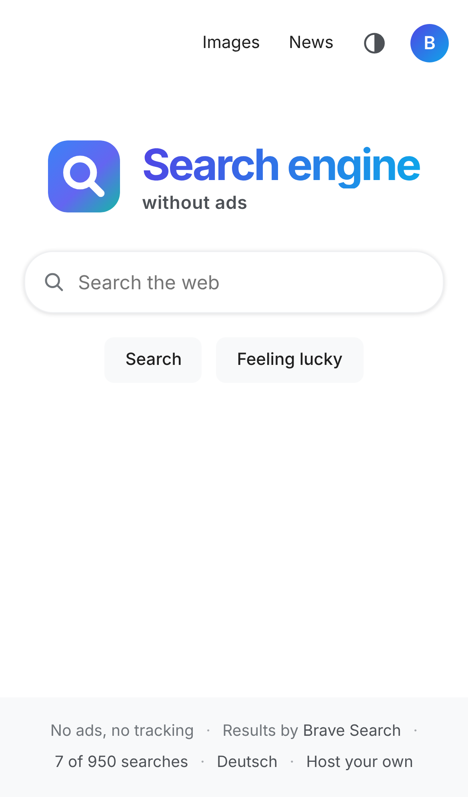
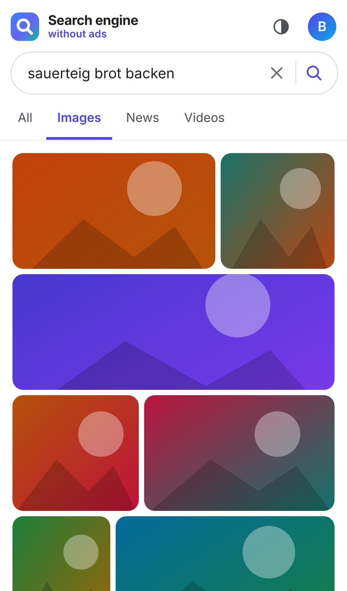
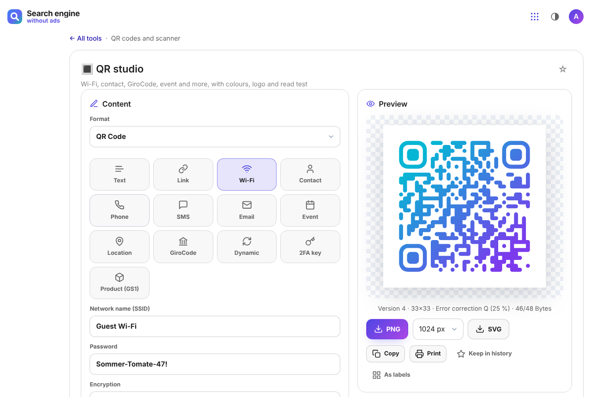
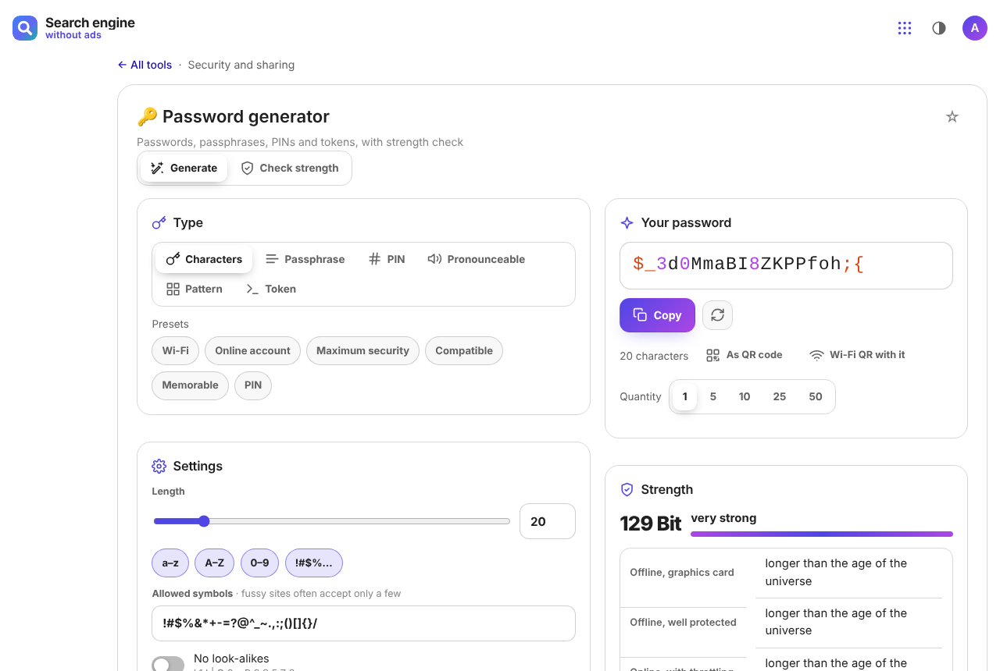
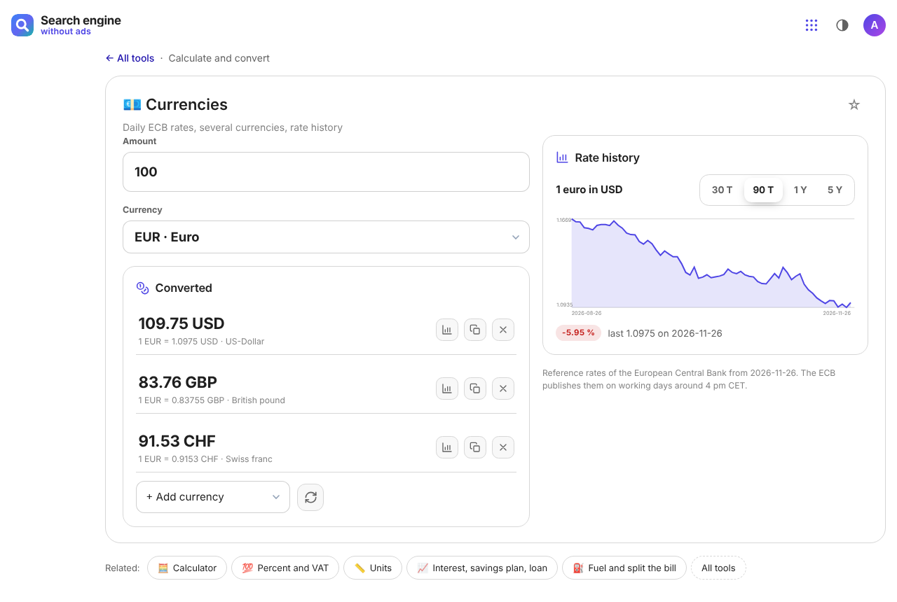

<p align="center"></p>

<h1 align="center">Search engine without ads</h1>

<p align="center"><b>Your own search engine. No ads, no tracking, on your own web space.</b><br>
Fast results from Brave Search, and when Brave can’t, straight away the search engine of your choice.<br>
Entirely within the free monthly quotas for normal private use, with a built-in brake before the limit.</p>

<p align="center"><a href="README.md">Deutsche Version</a> · <a href="../../releases/latest">Download the latest version</a></p>

<p align="center"></p>

Upload `suchmaschine-install.php`, open it in the browser, create your account, optionally paste the Brave key. That is the whole installation.

The server runs PHP and SQLite, the browser plain JavaScript and CSS. No frameworks, no dependencies, no build step, no MySQL. Runs on ordinary shared hosting.

## Screenshots

<table>
  <tr>
    <td align="center"><br><sub>Home page</sub></td>
    <td align="center"><br><sub>Dark theme</sub></td>
  </tr>
  <tr>
    <td align="center"><br><sub>Image search</sub></td>
    <td align="center"><br><sub>Image preview</sub></td>
  </tr>
  <tr>
    <td align="center"><br><sub>News</sub></td>
    <td align="center"><br><sub>Videos</sub></td>
  </tr>
  <tr>
    <td align="center"><br><sub>Suggestions from your own recent searches</sub></td>
    <td align="center"><br><sub>Admin: key, name, logo, color</sub></td>
  </tr>
</table>

<p align="center">
  
  
  
</p>

[Cost](#what-does-it-cost) · [Setting up Brave](#setting-up-brave-getting-api-keys) · [Features](#features) · [Guests and fallback](#guests-and-fallback-search-engine) · [Helpers from Brave](#helpers-from-brave) · [Big images](#big-images-also-with-other-search-engines) · [New in 1.5](#new-in-15) · [New in 1.4](#new-in-14) · [Reader mode and PDF](#reader-mode-and-pdf) · [New in 1.3](#new-in-13) · [New in 1.2](#new-in-12) · [Accounts and token login](#accounts-and-token-login) · [Keyboard shortcuts](#keyboard-shortcuts) · [Requirements](#requirements) · [Installation](#installation) · [Updating and backup](#updating-and-backup) · [Building it yourself](#building-it-yourself) · [Good to know](#good-to-know) · [Disclaimer](#disclaimer) · [License](#license)

## What does it cost?

Nothing for normal private use. Brave adds **$5 of credit per month** to every plan, which covers:

| Brave plan | For | Free per month (about) | Default limit here |
|---|---|---|---|
| [Search](https://brave.com/search/api/) | the search itself (web, images, news, videos) | 1,000 searches | 950 |
| Autosuggest | suggestions while typing | 10,000 requests | 9,950 |
| Spellcheck | “Did you mean …?” | 10,000 requests | 9,950 |
| Answers | AI answer above the results | 70 to 90 answers (depends on text length) | $4.50 |

- Only **Search** is needed, the other three are optional. It even works without any key: every search then goes straight to the fallback search engine.
- Every service gets **its own limit** in the admin page, set just below the free quota by default. When a limit is reached, the search engine stops **before** any costs arise.
- **Reset date:** Brave reports when the Search quota restarts, the search engine takes it over automatically. The other three count per calendar month.
- **Usage according to the dashboard:** enter what Brave’s dashboard shows as used at any time. The counter is set to exactly that and keeps counting from there.
- **Keep automatic top-up switched off.** To be doubly safe, also set a “Monthly usage limit” of $5 for every plan in the Brave dashboard.
- A **cache** makes reloading, the back button and paging free (up to 60 minutes, more is not allowed by Brave’s terms).
- **Instant answers**, **bangs**, **tools** and every search that goes to the **fallback search engine** cost nothing.

## Setting up Brave (getting API keys)

Enter the keys after installing under **Admin → Search services**. Every key (except Answers, where even the test would cost money) is checked with a test request first. Keys never belong in the code or in Git, they only live in your database in the `data/` folder.

1. Sign up at [api-dashboard.search.brave.com](https://api-dashboard.search.brave.com).
2. Choose the **“Search”** plan. Brave wants to see a **credit card** (against abuse), billing works with credit, no subscription. **Keep automatic top-up switched off.**
3. Create a key under **“API Keys”** (starts with `BSA`) and enter it in the search engine.
4. Optionally choose the **“Autosuggest”**, **“Spellcheck”** and **“Answers”** plans the same way. Every plan has **its own key**, which goes into the matching section.
5. Brave sends the reset date with every search, no reference date needed.

## Features

- **Web, images, news, videos** in tabs.
- **Mixed results** like the big search engines: top stories, videos, "People also ask" and forum discussions between the results, plus an **overview panel**.
- **Fallback search engine of your choice**, straight away and without a stop in between when Brave can’t, and always for guests.
- **Page by page or endless scrolling**, per account.
- **Time filter**, **language and region**, **verbatim**, **spelling correction** with "Search instead for …" and “Did you mean …?”, **"Feeling lucky"**.
- **Large image preview** with arrow keys and swiping, plus a **real full-screen mode** (button or key `F`) for TVs and big screens: borderless on black, controls fade out. The image is loaded in **full resolution through your own server**, without loosening the strict security rules and without using a Brave search. For other search engines’ image search there is the **“Big images”** bookmark.
- **File type filter** (PDF, DOCX, XLSX, PPTX, TXT, EPUB, CSV, ODT and more, or type any other extension). Kept while paging and endless scrolling.
- **Help page** with every search operator Brave supports (`site:`, `filetype:`, `intitle:`, `"…"`, `OR`, `NOT`, `-` …), clickable examples and an overview of your own bangs, lenses and domain lists.
- **Suggestions while typing:** from your own recent searches (stored only in the browser) and, if set up, from Brave.
- **Light and dark**, automatic or by button. **German and English.**
- **Phone and desktop**, can be added to the home screen as an app.
- **Default search in your browser** via OpenSearch.
- **Accounts:** whoever signs up first becomes the administrator and can add more accounts, e.g. for the family. Every account has its own settings, including its fallback search engine and the Brave helpers.
- **Admin page:** Brave with keys, reference date, limits and status, fallback search engine, name, **own logo**, **color**, defaults for everyone, usage with forecast, per-account quotas, site open to guests or sign-in only.
- **One-click updates** from GitHub releases, verified by checksum, with one-click rollback. Optionally automatic once a day.
- **Self-test** that the internal folders are really blocked from outside.
- **No ads, no tracking, no third-party scripts.** Strict Content Security Policy, links open without referrer.

## Guests and fallback search engine

- **Brave only searches for signed-in accounts.** Guests can still use the site: home page, bangs, instant answers, tools and help. Their searches **never use your Brave key**, they go straight to the fallback search engine. Whether guests may come in at all is set under *Admin → Settings → Guests*: **“Everyone (open)”** or **“Sign-in only”**.
- **Fallback search engine:** if Brave has no key, the limit is reached, the account’s quota is used up or Brave is down, the search goes on **straight away, without a stop in between**. Choose Startpage, DuckDuckGo, Brave Search (website), Ecosia, Qwant, Mojeek, Google, Bing or your own address with `{q}`. Images, news and videos land in the matching section there.
  - The administrator sets the **default** (*Admin → Search services*).
  - **Every account** picks its own under *Settings → Search*.
  - **Guests** pick theirs right on the home page, remembered only in their own browser.

## Helpers from Brave

Three optional extras, each with its own Brave plan, key, monthly limit and brake. Only for signed-in accounts, every account can switch them off under *Settings → Search*.

- **Search suggestions** while typing (Brave *Autosuggest*), below your own recent searches. Every suggestion is cached for an hour.
- **“Did you mean …?”** (Brave *Spellcheck*). Brave usually fixes typos in the search itself (“Results for …”), so the search engine only asks when it doesn’t: with “Verbatim” and when hardly anything was found.
- **AI answer** above the results (Brave *Answers*): off, on request (default) or automatic. The result list never waits for it. Brave charges per request **and per amount of text** here, an answer usually costs 5 to 7 cents. The search engine counts the real price Brave reports with every answer and stops before the limit.

## Big images, also with other search engines

With Brave the image preview shows every image in full resolution and full screen. For other search engines’ image search there is the **“Big images”** bookmark (Help → Big images):

- Tap it on the other image page: it collects the images in the largest version the page reveals and shows them **edge to edge on black**. Swipe or use the arrow keys to browse, `F` toggles full screen, `Esc` or swiping down closes.
- On a computer drag the button to the bookmarks bar. On iPad and iPhone bookmark any page, edit the bookmark and replace the address with the copied code.
- It works best with **Bing’s image search**, where the originals are right in the page. With other search engines you get the largest previews, depending on the page.
- The bookmark only runs in your browser and sends nothing to the server or anywhere else.

## Like ..., but free

Some paid search engine are known for a few ideas that are available here for everyone who self-hosts. Every account has **its own space**: what one person sets up, the others do not see.

- **Block, raise and lower domains.** Unwanted sites disappear, favorites move up with a small star, others drop to the end. Quickest via the ⋮ menu next to every result, or as lists under *Settings → Domains*. Filtering happens after fetching, so the cache stays the same for everyone.
- **Bangs** like `!w Berlin`, `!gh`, `!yt`, `!osm`, `!so`, `!r` jump straight to another site's search. They are handled before Brave is asked and **cost no credit**. `!i`, `!n` and `!v` switch to images, news and videos. **Over 10,800 bangs** from [Kagi’s open list](https://github.com/kagisearch/bangs) (MIT) are built in, plus German extras. Typing `!` (or the `!` button) suggests bangs and shows where they lead. Under *Settings → Bangs* you can search, edit and delete any bang and restore the defaults; admins can do this for everyone. The list updates itself weekly and targets are checked for reachability, without using searches. Works from the browser's address bar too.
- **Lenses** narrow the search to a topic such as forums, programming, wikis or science. Everyone can build **their own lenses** from domains and operators and hide the built-in ones. Pick one on the results page under "Lens".
- **Back up and restore:** under *Settings → Account* every account downloads its settings including lists, bangs and lenses as a file and restores them when needed, even on another installation. The administrator can also back up the installation settings.

## New in 2.0: the big tools upgrade

> **Version 2.0 is a mega upgrade.** 15 small helpers become **47 tools**, many of them real little apps. They all run on your own server or right in the browser, none of them asks a search service, none costs credits. The update installs with one click as usual, your data and short links stay.

<p align="center"></p>

<table>
  <tr>
    <td align="center"><br><sub>QR studio with design and read test</sub></td>
    <td align="center"><br><sub>Password generator with strength check</sub></td>
  </tr>
  <tr>
    <td align="center"><br><sub>Currencies with ECB rate history</sub></td>
    <td align="center"><br><sub>Weather with hours, 7 days and official warnings</sub></td>
  </tr>
</table>

**Overview:** tool search (key `/`), favourites with ☆, “recently used”, shortcuts in the search box such as `!qr Hello`, `!pw`, `!short https://…`, `!json`, `!dns example.org`.

**QR codes and scanner** (building blocks from CodeForge, same author)
- **QR studio:** templates for link, text, Wi-Fi, contact (vCard), phone, SMS, email, event, location, **GiroCode**, **2FA key**, product (GS1) and **dynamic QR codes** (they point to your own short link, the target can be changed later). Colours, gradients, six dot shapes, custom corners, **logo in the centre**, frame with caption. Also Data Matrix, Aztec, PDF417 and all barcodes. Export as PNG (up to 4096 px) and SVG.
- **Read test:** every code is automatically printed small, blurred, tilted and darkened and read back, with a print size recommendation.
- **Scanner:** webcam on the PC, camera on the phone (with torch, zoom, camera switch), photos and screenshots (also with Ctrl+V). QR, Data Matrix, Aztec, PDF417, EAN, UPC, Code 128 and more. Batch and inventory mode with CSV.
- **Search what you scan:** camera button in the search box, scan a barcode, ISBN or text and the search starts right away. In the scanner optionally with “Search right away”.
- **Link X-ray against quishing:** shows the real domain, warns about look-alike addresses (`pаypal.com` with a Cyrillic a), foreign brand names, IP addresses and tricks. The server resolves short links without opening the page.
- **Print QR:** guest Wi-Fi sign, table card, business card, donation sign, label sheets (Avery, Herma, label printers) with serial numbers.
- **Number detective:** check IBAN, EAN, ISBN, ISSN, PZN, IMEI, with check digit and a hint which digits were swapped.

**Security and sharing**
- **Password generator:** random characters, passphrases (large German and English word lists), PINs without 1234 and the like, pronounceable, custom pattern, tokens (hex, Base64url, Base32, UUID). Presets for Wi-Fi, online account, maximum security and fussy sites, 50 at once with CSV, **strength check** for your own passwords with crack time and pattern detection. Everything in the browser only.
- **Short links 2.0** (ideas from [ShrinkURL](https://github.com/burnersen/ShrinkURL)): custom name, expiry date, visit limit (“only once”), password, intermediate page against messenger previews, preview with `+` at the end, remove tracking parameters, change the target later, on/off, **statistics as a daily counter only** (no IP, no cookie), target title, check targets for dead links, CSV, bookmarklet, entry in the phone's share menu.
- **Text snippets:** encrypted in the browser (AES-256-GCM), the key is only in the link after the `#`. Expiry, “gone after reading”, optional password (a wrong password does not use up a view).

**Calculating:** calculator that works as you type (history, scientific, degrees/radians), percent and VAT, rule of three, live units (now also fuel economy, pressure, energy, power, angle, cooking), currencies with several targets and **ECB rate history**, compound interest, savings plan, loan with repayment plan, fuel costs, split the bill, Roman numerals, Morse code with sound and light.

**Time and date:** several timers at once, Pomodoro, interval training, alarm, stopwatch with laps (timers survive a reload), countdown with title, full screen and link, **working days with the holidays of a German state**, weekday, **bridge day planner**, holidays as a **calendar file (.ics)**, printable year calendar, world clock with meeting planner.

**Network and web** (after signing in, with safe fetching modelled on [LinkVault](https://github.com/burnersen/LinkVault)): what sites see about you (headers, browser, WebRTC), is the site down?, headers and redirects with security check, SSL certificate, DNS with SPF and DMARC, WHOIS via RDAP, link checker for up to 200 links, **link preview** (how your link looks in messengers), **clean up bookmarks** (remove duplicates and dead links from a browser export).

**For developers:** JSON (format, validate, CSV), encode (Base64, URL, HTML, hex, binary, Unicode), hash (SHA-256/512, SHA-1, MD5, CRC32, HMAC, also of files), JWT decoder with signature check, UUID v4/v7, ULID, Nano ID, regex tester, cron explainer with the next runs, compare text, colours with WCAG contrast, number systems, subnet calculator (IPv4 and IPv6), chmod, `.htpasswd`, text tools, Unix timestamp.

**Everyday:** Lotto 6 out of 49, Eurojackpot, draw a card, yes or no, **weather with hours, 7 days, UV and official German Weather Service warnings**.

**Removed:** “draw lots and make groups”.

**Privacy stays:** passwords, QR contents, hashes, JWTs, regexes and texts never leave the browser. Outbound requests (network tools, link X-ray) are made only by your server, only to public addresses, without storing anything. The scan engine (zxing-wasm, MIT) lives on your server and is only loaded when you scan.

## New in 1.5

- **Tools reorganised:** a tile overview by group (calculating, time and date, chance, sharing and security, weather and network); every tool opens on **its own page** instead of one long list, with related tools below. Reachable everywhere via the **grid icon at the top right**, also for visitors when searching without an account is allowed.
- **Settings tidied up:** login token and “default search in the browser” are now together under **Settings → Browser**. The administrator edits the look for everyone under **Admin → Appearance**.
- **Getting API keys, step by step,** right next to each search service in the admin page.
- **1.5.1:** currency rates once a day after the ECB plus a “Fetch rates now” button. “My IP address” can also show your IPv4 on an IPv6 connection (and vice versa), ideally via your own IPv4-only subdomain (Admin → Settings), otherwise on click via ipify.org. The appearance preview stays visible while scrolling.
- **1.5.2:** endless scrolling only loads more after you reach the bottom and deliberately pull on.
- **1.5.3:** “Usage according to dashboard” sets a service's counter to exactly the dashboard value and keeps counting from there (for every service that does not report its usage).
- **1.5.4 and 1.5.5:** signed updates tried and switched off again. Updates are checked by checksums; signing stays optional (see [BUILD.md](BUILD.md)).
- Small fixes: the name on the results page is no longer cut off, a more compact currency card, tabs on phones show that they scroll. Without any search service, the administrator is sent to the setup instead of being redirected.
- **For developers:** code split by topic, English texts in `app/lang/en.php`, automated tests, checks on every push, reproducible builds, optional signed updates. Users still get **one single installation file**. How it is built: [BUILD.md](BUILD.md).

## New in 1.4

- **Appearance** (Settings → Appearance, per account, with an installation default): 17 light and dark designs, including muted ones (Paper, Mist, Sage, Slate, Dusk), the colour mixer from “Kaufen” with sliders, colour code, live preview, contrast warning and automatic matching, five built-in fonts served from your own server (Atkinson Hyperlegible, Lexend, Source Sans 3, Inter, Literata, all SIL OFL, nothing from Google), sizes, line spacing, spacing and list width.
- **Endless or paged for all tabs.** **Loading with resistance:** plain scrolling loads nothing; only after reaching the bottom and deliberately pulling on (a clear swipe on phones, several wheel notches) do more results load. **Images:** 200 per request, paging is free afterwards.
- **News:** Brave fetches 50 at once. Empty sections are skipped.

## Reader mode and PDF

“Read without ads” in the **⋮** menu of every result (accounts only): your server fetches the page and keeps only the content. Recipes are detected from their structured data (ingredients, steps, image), switchable to the whole article. **Save as PDF** in the browser with live preview, font, size, line spacing, 1 or 2 columns, margins and selectable images, or **Print**.

**Please use it fairly:** for private reading and archiving only. Accounts only, at most 60 pages per hour, nothing is stored on the server, paywalls are not bypassed, and source, date and “for private use only” appear in the view and on every PDF page. Rights remain with the original sites.

## New in 1.3

- **Newest first** is the default for "All" and news. Every account can change it under *Settings → Search*, the administrator sets the default for everyone. Switch any time with "Sorting" above the results.
- **News from the last 24 hours.** At the end of the list it continues with the last week, then the last month and the last year. If there is no recent news at all, the range widens right away. Range and widening are per account.
- **Reset date from the service:** Brave reports with every search when its quota restarts. The used amount can be synced under **“Usage according to dashboard”**.
- **New tab everywhere:** "Open links in a new tab" applies to every outgoing link, including weather, overview panel and loaded results.
- **Bangs without flashing:** the redirect page is empty and uses the page colours; a "Continue" button only appears after 2 seconds if the target hangs.

## New in 1.2

**Search service, failures, fallback**
- Searches go to **Brave Search**. If Brave returns an error or cannot be reached, it pauses briefly so no search has to wait for it, and searches go straight to the fallback search engine meanwhile. The admin page shows last success, last error and average response time.

**Usage, forecast, quotas:** per service used/limit, period, **reset date with days left**, today, **daily average**, **projection until the reset** and a clear verdict whether it lasts. A banner warns administrators from 80 % (configurable). **Per-account quotas** decide which services an account may use and how many credits it gets; "Split fairly" divides the limits evenly.

**Instant answers (free):** `(12.5 + 7) * 3`, `200 + 19%`, `15% of 80` (own parser, no `eval`) · `100 usd in eur` (ECB rates, cached daily) · `10 km in miles`, `20 °c in f`, `1 gib in mb` · `weather london` (German Weather Service via Bright Sky, Open-Meteo or wttr.in) · `my ip` · `week`, `week 12` · `date` · `dice`, `2d20`, `coin`, `random 1-49` · `timer 5 min`, `stopwatch`, `countdown christmas` · `password 32`, `passphrase` · `qr https://…` · `short https://…`.

**Tools** (grid icon at the top right): 47 helpers in one place, by group, with search, favourites and “recently used”, each on a page of its own (see [New in 2.0](#new-in-20-the-big-tools-upgrade)). In the search box: `days between 2026-01-01 and 2026-12-24`, `workdays between 2026-12-01 and 2026-12-31 bavaria`, `age 1940-05-12`, `holidays 2027 bavaria`, `bridge days 2027 nrw`, `lotto`, `!qr Hello`, `!pw`, `!short https://…`.

**Filters and results:** strict sort by date (newest first, undated last), **max. 3 results per domain** (on by default), **"Reset all filters"**, a large **×** in the search box, and in the **⋮ menu**: search only this domain, archive at web.archive.org and archive.today, show as QR code, copy address.

**Images:** filters for orientation (landscape, portrait, square) and size (very large from 1 MP, large from 0.3 MP, medium, small below 0.15 MP), **sort by resolution**, and a full screen that always shows the whole image centred on black, never cropped.

**Complete backup:** under *Admin → Backup* one file with everything (settings, all API keys, accounts with password hashes, login tokens, personal settings, quotas, short links, usage, logo), **optionally encrypted with a password** (AES-256-GCM, key derived with PBKDF2).

## Accounts and token login

- The first visitor creates the administrator account. The Brave key is optional there; keys can be added later under *Admin → Search services*. More accounts are created under *Admin → Accounts*, optionally with a quota.
- **Login token:** under *Settings → Browser* every account creates a long secret token (48 characters) or sets its own (at least 32 characters, at least three kinds of characters). Token, login address and search address can be shown, copied and renewed there, only while signed in.
- `https://your-domain/search/?token=YOUR_TOKEN` (also combined: `?token=…&q=…`) signs you in and sets a session cookie for **365 days** (`HttpOnly`, `Secure` on HTTPS, `SameSite=Lax`). The token is removed from the address right away by a redirect. The session lives on the server (the cookie holds a random value, the database only its hash), so it can be ended anytime: sign out, clear cookies or *Sign out all other devices*.
- **Default search:** add the search address with token (`…/?token=…&q=%s`) to your browser, or in Firefox add it from the account page via the magnifier icon (OpenSearch with token).
- **Security:** wrong tokens are throttled (growing wait after 5 failures), comparison is constant-time, the token is stored encrypted with a key in `data/config.php`. Treat it like a password; web server logs may record addresses containing it.

## Keyboard shortcuts

`↓`/`J` and `↑`/`K` move through the results with a visible frame · `Enter` opens (with `Ctrl`/`⌘` in a new tab) · `←` `→` previous/next page or image · `/` focuses the search box · `F` full screen in the image preview · `?` shows all shortcuts · `Esc` closes overlays, menus, preview and full screen. They only work when no input field is focused.

## Requirements

- Web space with **PHP 8.0 or newer** and the extensions `pdo_sqlite` and `curl`.
- Outgoing connections allowed: to `api.search.brave.com`, for instant answers to `api.frankfurter.dev`, `geocoding-api.open-meteo.com`, `api.brightsky.dev`, `api.open-meteo.com`, `wttr.in`, `*.wikipedia.org`, and for updates to `github.com`.
- The `openssl` extension for the encrypted backup and the encrypted login tokens (almost always available).
- **HTTPS.**
- **Apache** (or LiteSpeed) blocks the internal folders by itself via `.htaccess`. **nginx** needs two lines in the configuration, see below.
- Optionally a **Brave key** (free, see above). Without a key every search goes to the fallback search engine.

## Installation

1. Optionally **get a Brave key**, see [Setting up Brave](#setting-up-brave-getting-api-keys). Without a key every search goes to the fallback search engine.
2. Download **`suchmaschine-install.php`** from the [latest release](../../releases/latest) and copy it to a folder on your web space.
3. Open it in the browser **right away** and click **"Install now"**. It unpacks the program, deletes itself and redirects.
4. **Create your account** right afterwards and optionally **paste the Brave key**. The key is checked with a test search. This account is the administrator. The optional Brave helpers (suggestions, spellcheck, AI answer) are added later under *Admin → Search services*.
5. **Test:** in Admin → *Update → Data protection* click "Check now". It must say "All tight".

On **Plesk** hosts (e.g. Netcup), nginx in front of Apache may serve files directly and skip `.htaccess`. Open the domain's **"Apache & nginx Settings"** and turn off **"Serve static files directly by nginx"** / **"Smart static files processing"**.

With your own nginx configuration, add this to the `server` block (adjust the path if installed in a subfolder):

```nginx
location ^~ /data/ { deny all; return 404; }
location ^~ /app/  { deny all; return 404; }
```

## Updating and backup

Admin → *Update* → "Check for updates" → "Update now". The running version is saved first and can be restored with one click. Or upload a new `suchmaschine-install.php` and open it: only program files are replaced, `data/` is never touched. Set `'update_url' => ''` in `data/config.php` to switch off update checks.

Everything that matters is in the folder **`data/`**: accounts, settings, API keys, logo. Download that folder to back up. In the browser: the **complete backup** (optionally encrypted) and the installation settings under *Admin → Backup*, personal settings of every account under *Settings → Account*.

## Building it yourself

The source is split into many files, users still get **one file**. Anyone can build it with nothing but PHP: `php tools/build-release.php` checks the syntax, runs all tests, builds `dist/suchmaschine-install.php`, installs it as a test and writes checksums. Builds are reproducible, so every release can be compared with the source. Details, including signed updates: [BUILD.md](BUILD.md). Contributing: [CONTRIBUTING.md](CONTRIBUTING.md), security issues: [SECURITY.md](SECURITY.md).

## Good to know

- **Privacy:** Brave sees the search terms but not who searches, the request comes from your server. The fallback search engine, however, is visited by the browser directly and sees the visit like any other. Only the number of requests per account is counted, never their content. The search engine itself stores no search terms except briefly in the cache. Recent searches for suggestions stay in each device's browser.
- **Full-resolution images:** for the large preview the server fetches the original image and passes it on. The other site only sees the server, the browser still only loads from your own address. Every image address is signed, internal networks are blocked, nothing is stored. It costs no search, only some traffic, and can be switched off in the admin page.
- **Search operators** are passed to the search service unchanged. Brave understands most of them, the other services mainly quotes and `site:`.
- **Endless scrolling:** every reload is a real Brave search, so 20 results are fetched at a time. Brave delivers at most 10 pages per query.
- **Providers' terms:** results may not be resold, Brave only allows short-term caching. The services used are named at the bottom of every page.

## Security

For 1.2 the search engine was reviewed from an attacker's point of view and hardened: every output escaped and a strict CSP without inline scripts (XSS) · session token plus same-origin check on every form, token login only when opened directly and never silently switching accounts (CSRF) · prepared statements only (SQL injection) · signed image proxy limited to public IPs with pinned DNS, fixed HTTPS targets without redirects for weather, rates and Wikipedia (SSRF) · throttled password and token logins with constant-time comparisons (brute force, timing) · own calculator parser without `eval` · fixed file names and checksummed updates (path traversal) · login tokens encrypted at rest, server-side sessions that can be ended anytime.

## Disclaimer

Free hobby software, provided **as is, without any warranty**. Use at your own risk. Whoever runs it is responsible for the server, its updates and backups, and for complying with the providers' terms. This project is not affiliated with Brave Software, Bright Data or Google.

## License

GNU Affero General Public License v3.0, see [LICENSE](LICENSE).

Built in since 2.0: scan engine [zxing-wasm](https://github.com/Sec-ant/zxing-wasm) (MIT) with zxing-cpp (Apache 2.0), details in `app/assets/vendor/LIZENZEN.txt`. Passphrase word lists: German from [dys2p/wordlists-de](https://github.com/dys2p/wordlists-de) (CC0), English from the [EFF](https://www.eff.org/deeplinks/2016/07/new-wordlists-random-passphrases) word lists (CC BY 3.0 US). Icons in the style of Lucide (ISC).
