<p align="center"></p>

<h1 align="center">Suchmaschine ohne Werbung</h1>

<p align="center"><b>Deine eigene Suchmaschine. Ohne Werbung, ohne Tracking, auf deinem eigenen Webspace.</b><br>
Echte Google-Ergebnisse (über Bright Data) und Brave Search, mit Lastverteilung und Ausweichen bei Störungen,<br>
bei normaler privater Nutzung komplett in den kostenlosen Monatskontingenten.</p>

<p align="center"><a href="README.en.md">English version</a> · <a href="../../releases/latest">Neueste Version herunterladen</a></p>

<p align="center">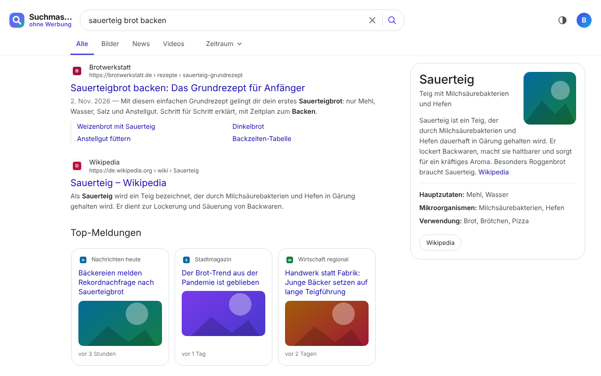</p>

> ⚽ **Neu in 2.4:** Live-Karten wie bei Google bei jeder Suche, auch mit „Neueste zuerst“: das Spiel von heute mit Wappen und Anstoß, Kurse, Öffnungszeiten, Promi-Alter. [Mehr dazu](#neu-in-24-live-karten-wie-bei-google)
>
> ⚡ **Neu in 2.3:** Die Seite steht sofort da, Google und Brave laufen um die Wette, **Neueste zuerst** überall mit automatischen Zeitstufen, Bilder in **bester Qualität zuerst** und **Suchvorschläge** beim Tippen. [Mehr dazu](#neu-in-23-schneller-neueste-zuerst-beste-bilder)
>
> 🚀 **Version 2.2, Google-Ergebnisse.** Über Bright Data kommen echte Google-Ergebnisse für Web, Bilder, News und Videos, 5.000 Anfragen im Monat kostenlos. Dazu Live-Infos (Spielstände, Kurse, Öffnungszeiten, KI-Übersicht) und Filter wie bei Google. [Alles, was neu ist](#neu-in-22-google-ergebnisse-über-bright-data)

Einfach `suchmaschine-install.php` hochladen, im Browser aufrufen, Konto anlegen, einen oder mehrere API-Keys einfügen. Das ist die ganze Installation.

Auf dem Server laufen PHP und SQLite, im Browser schlichtes JavaScript und CSS. Keine Frameworks, keine Abhängigkeiten, kein Build-Schritt, keine MySQL-Datenbank. Läuft auf ganz normalem Shared Webhosting.

## Bilder

<table>
  <tr>
    <td align="center"><br><sub>Startseite</sub></td>
    <td align="center">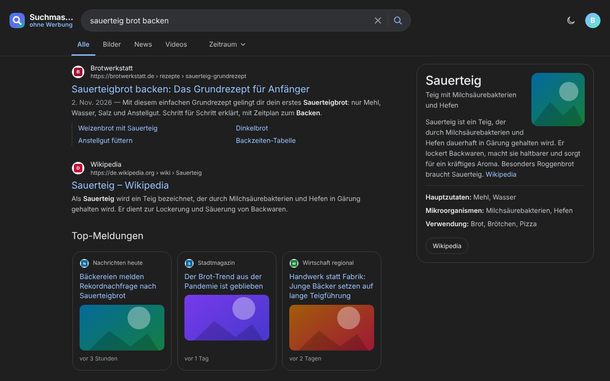<br><sub>Dunkles Design</sub></td>
  </tr>
  <tr>
    <td align="center">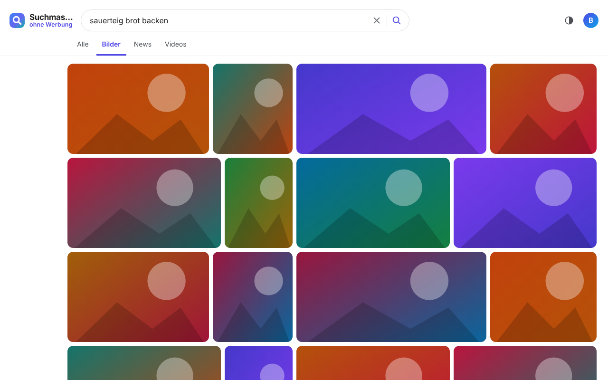<br><sub>Bildersuche</sub></td>
    <td align="center">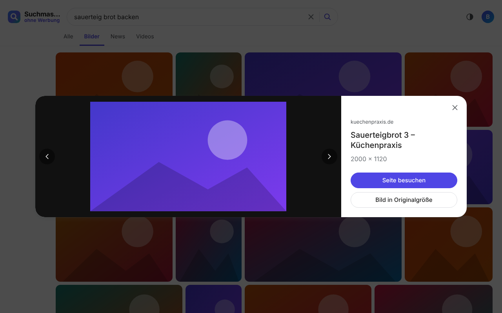<br><sub>Bildvorschau</sub></td>
  </tr>
  <tr>
    <td align="center">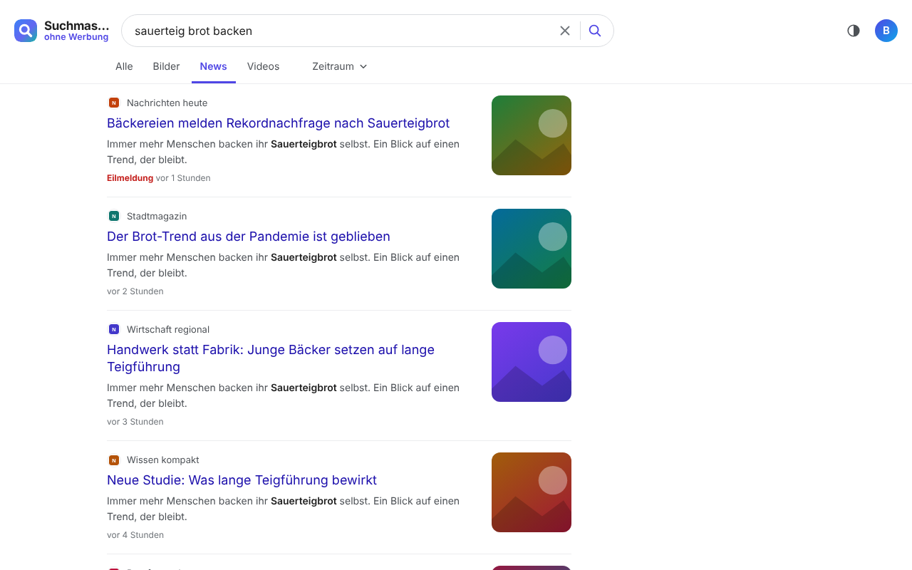<br><sub>News</sub></td>
    <td align="center"><br><sub>Videos</sub></td>
  </tr>
  <tr>
    <td align="center">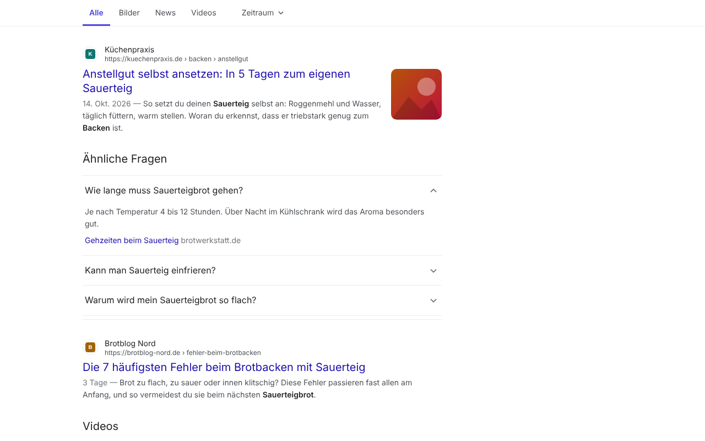<br><sub>Ähnliche Fragen</sub></td>
    <td align="center"><br><sub>Vorschläge aus den eigenen letzten Suchen</sub></td>
  </tr>
  <tr>
    <td align="center"><br><sub>Verwaltung: Key, Name, Logo, Farbe</sub></td>
    <td align="center"><br><sub>Verwaltung: Konten</sub></td>
  </tr>
</table>

<p align="center">
  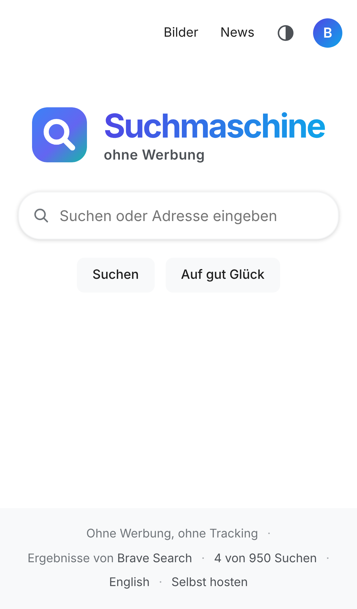
  
  
</p>

[Kosten](#was-kostet-das) · [Suchdienste einrichten](#suchdienste-einrichten-api-keys-holen) · [Funktionen](#funktionen) · [Neu in 2.3](#neu-in-23-schneller-neueste-zuerst-beste-bilder) · [Neu in 2.2](#neu-in-22-google-ergebnisse-über-bright-data) · [Neu in 2.0](#neu-in-20-das-große-werkzeug-upgrade) · [Neu in 1.5](#neu-in-15) · [Neu in 1.4](#neu-in-14) · [Lesemodus und PDF](#lesemodus-und-pdf) · [Neu in 1.3](#neu-in-13) · [Neu in 1.2](#neu-in-12) · [Konten und Token-Login](#konten-und-token-login) · [Tastenkürzel](#tastenkürzel) · [Voraussetzungen](#voraussetzungen) · [Installation](#installation) · [Daten schützen](#daten-schützen) · [Aktualisieren](#aktualisieren) · [Sichern](#sichern) · [Aufbau](#aufbau) · [Selbst bauen](#selbst-bauen) · [Gut zu wissen](#gut-zu-wissen) · [Haftungsausschluss](#haftungsausschluss) · [Lizenz](#lizenz)

## Was kostet das?

Bei normaler privater Nutzung nichts. Die Suchmaschine kann zwei Such-APIs nutzen, jede mit eigenem kostenlosen Monatskontingent. Schon eine reicht, beide zusammen ergeben einen dicken Puffer:

| Dienst | Kostenlos pro Monat | Gezählt wird in | Standardlimit | Kann |
|---|---|---|---|---|
| [Bright Data](https://brightdata.com) (Google) | **5.000 Anfragen**, Reset am Monatsersten | Anfragen | 4.950 | Web, Bilder, News, Videos, Infobox mit Öffnungszeiten, Spielstände, Kurse, KI-Übersicht, alle Google-Filter |
| [Brave Search](https://brave.com/search/api/) | 5 $ Guthaben, etwa **1.000 Suchen** | Suchen | 950 | Web, Bilder, News, Videos, Infobox |

- Pro Dienst stellst du in der Verwaltung ein **eigenes Limit** ein. Voreingestellt ist immer das Freikontingent **minus 50 als Puffer**. Ist ein Limit erreicht, nimmt die Suchmaschine automatisch den nächsten Dienst.
- **Reset-Datum:** Brave meldet selbst, wann sein Kontingent neu startet, das übernimmt die Suchmaschine automatisch. Bei Bright Data ist es der Monatserste (ohne Stichtag voreingestellt).
- **Verbrauch laut Dashboard:** Trag in der Verwaltung jederzeit ein, was das Dashboard gerade als verbraucht zeigt. Der Zähler wird genau auf diesen Stand gesetzt und zählt von da an weiter, praktisch auch, wenn du den Key mitten im Monat einträgst.
- **Keine Karte hinterlegen** bzw. automatisches Aufladen ausschalten. Bei Bright Data steht der Plan auf „Pay as you go“ (1,50 $ pro 1.000 Anfragen über dem Freikontingent): ohne Karte kann nichts abgebucht werden, und das Limit in der Suchmaschine hält vorher an.
- Ein **Zwischenspeicher** sorgt dafür, dass Neuladen, Zurück-Knopf und Blättern nichts kosten: bei Brave bis 60 Minuten (mehr erlauben Braves Bedingungen nicht), bei Google standardmäßig 1 Stunde (Spielstände und Kurse höchstens 5 Minuten).
- **Sofort-Antworten** (Rechner, Währungen, Wetter …), **Bangs** und **Werkzeuge** kosten gar nichts, weil sie keinen Suchdienst fragen.

Zum Vergleich: Wer 10 Mal am Tag sucht, kommt auf rund 300 Suchen im Monat.

## Suchdienste einrichten (API-Keys holen)

Die Keys trägst du nach der Installation unter **Verwaltung → Suchdienste** ein. Jeder Key wird vorher mit einer Testsuche geprüft. Dienste ohne Key tauchen nirgends auf. Keys gehören **nie** in den Code oder ins Git, sie liegen nur in deiner Datenbank im Ordner `data/`.

**Bright Data (Google)**
1. Auf [brightdata.com](https://brightdata.com) ein Konto anlegen. **Keine Karte hinterlegen**, dann kann nichts abgebucht werden.
2. Unter **„Web Access“ → „Add API“** die **„SERP API“** wählen.
3. Einen **Namen** vergeben (z. B. `serp_api1`, lässt sich später nicht ändern), bei **Data format „Full JSON“** wählen, „Google Ads“ auf Standard, die **erweiterten Einstellungen aus** lassen (keine eigenen Header, keine asynchronen Anfragen) und unten auf **„Add API“** tippen.
4. Danach zeigt Bright Data den **API-Key** (sieht aus wie `1a2b3c4d-…`). In der Suchmaschine unter *Verwaltung → Suchdienste* den Namen aus Schritt 3 als **Zone** und den Key eintragen.
5. Optional für den Lesemodus: noch eine **„Web Unlocker API“** anlegen und ihren Namen als **Zone des Web Unlockers** eintragen. Dann lassen sich Seiten, die den Server aussperren, über Bright Data laden (1 Anfrage pro Seite, aus demselben Kontingent).

**Brave Search**
1. Auf [api-dashboard.search.brave.com](https://api-dashboard.search.brave.com) ein Konto anlegen.
2. Den Plan **„Search“** wählen. Brave möchte eine **Kreditkarte** sehen (gegen Missbrauch), abgerechnet wird über Guthaben ohne Abo. **Automatische Aufladung ausgeschaltet lassen.**
3. Unter **„API Keys“** einen Key erzeugen (beginnt mit `BSA`).
4. Das Reset-Datum schickt Brave bei jeder Suche mit, ein Stichtag ist nicht nötig. Den bisherigen Verbrauch im laufenden Monat (Dashboard unter „Usage“) kannst du unter „Verbrauch laut Dashboard“ eintragen.

**Tipp:** In der Verwaltung legst du außerdem die **Reihenfolge** fest (wer zuerst gefragt wird), schaltest die **Lastverteilung** an oder aus, wählst die Dienste für **„Alle zusammen“** und das **Ausweichziel** für den Notfall.

## Funktionen

- **Web, Bilder, News, Videos** in Reitern, wie man es kennt.
- **Gemischte Ergebnisse** wie bei den großen Suchmaschinen: Top-Meldungen, Videos, „Ähnliche Fragen“ und Diskussionen aus Foren erscheinen zwischen den Treffern, dazu eine **Kurzinfo** am Rand (z. B. aus Wikipedia). Was Brave zu einer Suche liefert, wird angezeigt.
- **Seitenweise oder endlos scrollen**, für jedes Konto einstellbar.
- **Zeitraum-Filter** (letzte Stunde, 24 Stunden, Woche, Monat, Jahr oder **von/bis**), **Sprache und Region** pro Suche, **Wortgenau**, **Rechtschreibkorrektur** mit „Stattdessen suchen nach …“, **„Auf gut Glück“**.
- **Bildvorschau** im Großformat mit Pfeiltasten und Wischen zum Blättern, dazu ein **echter Vollbild-Modus** (Knopf oder Taste `F`) für Fernseher und große Bildschirme: randlos auf Schwarz, Bedienelemente blenden sich aus. Das Bild kommt dabei in **voller Auflösung über den eigenen Server**, ohne die strengen Sicherheitsregeln aufzuweichen und ohne Suche bei Brave.
- **Dateityp-Filter** (PDF, DOCX, XLSX, PPTX, TXT, EPUB, CSV, ODT und mehr, oder jede andere Endung zum Eintippen). Bleibt beim Blättern und Endlos-Scrollen erhalten.
- **Hilfeseite** mit allen Suchoperatoren, die Brave kennt (`site:`, `filetype:`, `intitle:`, `"…"`, `OR`, `NOT`, `-` …), mit Beispielen zum Anklicken und der Übersicht über die eigenen Bangs, Linsen und Domain-Listen.
- **Vorschläge aus den eigenen letzten Suchen.** Die bleiben nur im Browser, der Server merkt sich nichts.
- **Hell und dunkel**, automatisch nach dem Gerät oder per Knopf.
- **Deutsch und Englisch**, je nach Browser, umschaltbar unten auf der Seite.
- **Für Handy und Rechner**, lässt sich auch als App auf den Startbildschirm legen.
- **Als Standardsuche im Browser** eintragbar (OpenSearch), z. B. in Firefox mit einem Klick.
- **Konten:** Wer sich als Erster einträgt, wird Administrator und kann weitere Konten anlegen, etwa für die Familie. Jedes Konto hat eigene Einstellungen (Region, Sprache, SafeSearch, neuer Tab, Seiten oder endlos, Domain-Listen, Bangs, Linsen).
- **Verwaltung** für den Administrator: Suchdienste mit Keys, Stichtag, Limits und Status, Name der Suchmaschine, **eigenes Logo**, **Farbe**, Voreinstellungen für alle, Verbrauch mit Prognose, Kontingente pro Konto, auf Wunsch Suchen ohne Anmeldung (mit Grenze pro Stunde), Bilder in voller Auflösung an oder aus, Sicherung der Einstellungen.
- **Updates per Knopfdruck:** Die Suchmaschine schaut beim neuesten Release auf GitHub nach, prüft die Datei per Prüfsumme, sichert die laufende Version und spielt die neue ein. Zurück zur vorigen Version geht mit einem Klick. Auf Wunsch einmal am Tag automatisch.
- **Selbsttest:** Die Verwaltung prüft, ob die internen Ordner von außen wirklich gesperrt sind, und warnt sonst.
- **Ohne Werbung, ohne Tracking, ohne fremde Skripte.** Strenge Sicherheitsregeln (Content Security Policy), Links öffnen ohne Referrer, Vorschaubilder kommen über Braves Bild-Proxy oder über den eigenen Server. Googles Weiterleitungs-Links löst der eigene Server auf, Google erfährt nicht, was du anklickst.

## Wie bei ..., nur kostenlos

Bezahlte Suchmaschinen sind für ein paar Ideen bekannt, die es hier für alle gibt, die selbst hosten. Jedes Konto hat dabei **seinen eigenen Bereich**: Was einer einrichtet, sehen die anderen nicht.

- **Domains blockieren, hochstufen, herabstufen.** Unerwünschte Seiten verschwinden ganz, Lieblingsseiten rücken nach oben und bekommen einen kleinen Stern, andere rutschen nach hinten. Am schnellsten über das Menü ⋮ neben jedem Treffer, oder als Liste unter *Einstellungen → Domains*. Gefiltert wird erst nach dem Abruf, der Zwischenspeicher bleibt also für alle gleich.
- **Bangs** wie `!w Berlin`, `!gh`, `!yt`, `!osm`, `!so`, `!r`, `!dl`, `!leo` springen direkt zur Suche einer anderen Seite. Sie werden abgefangen, bevor Brave gefragt wird, und **kosten kein Guthaben**. `!i`, `!n` und `!v` wechseln zu Bildern, News und Videos. Mitgeliefert werden **über 10.800 Bangs** aus der offenen Liste von [Kagi](https://github.com/kagisearch/bangs) (MIT-Lizenz) plus deutsche Extras. Beim Tippen von `!` (oder über den `!`-Knopf) schlägt das Suchfeld passende Bangs vor und zeigt, wohin es geht. Unter *Einstellungen → Bangs* lässt sich jedes Bang suchen, bearbeiten, löschen und der Grundzustand wiederherstellen; Administratoren können das auch für alle. Die Liste aktualisiert sich wöchentlich selbst, und die Zielseiten werden nach und nach auf Erreichbarkeit geprüft, beides ohne Suchanfragen und abschaltbar. Funktioniert auch aus der Adressleiste des Browsers.
- **Linsen** schränken die Suche auf ein Thema ein, etwa Foren, Programmieren, Wikis oder Wissenschaft. Jeder kann **eigene Linsen** aus Domains und Operatoren bauen und die mitgelieferten ausblenden. Auswahl auf der Ergebnisseite unter „Linse“.
- **Sichern und wiederherstellen:** Unter *Einstellungen → Konto* lädt jedes Konto seine Einstellungen samt Listen, Bangs und Linsen als Datei herunter und spielt sie bei Bedarf wieder ein, auch auf einer anderen Installation. Der Administrator kann zusätzlich die Einstellungen der Installation sichern.

## Neu in 2.5: schneller sichtbar, Menü auch bei News und Videos

- **Warteseite sofort:** Nach Enter steht die Seite mit Suchfeld, Filtern und „Suche läuft …“ sofort da, auch bei Hostern, die Antworten sonst erst am Stück schicken (z. B. Plesk mit nginx vor Apache). Die Suche läuft im Hintergrund, danach lädt die Seite die fertigen Treffer aus dem Zwischenspeicher. Wer bei Plesk unter *Apache & nginx Settings* `fastcgi_buffering off;` einträgt, bekommt zusätzlich das Streaming ohne Umweg.
- **Länger zwischenspeichern:** Google-Ergebnisse bleiben standardmäßig 6 Stunden (News und die letzten 24 Stunden 1 Stunde, Spielstände und Kurse 5 Minuten). Wiederholte Suchen und „Zurück“ sind sofort da und kosten nichts.
- **Drucken repariert:** Jahreskalender, Feiertage, Werkzeuge und Suchergebnisse drucken sauber (vorher tat der Knopf beim Kalender nichts, und Werkzeug-Seiten druckten leer).
- **Menü ⋮ auch bei News und Videos** (und besser erkennbar): Hochstufen, Herabstufen, Blockieren, nur auf dieser Domain suchen, ohne Werbung lesen, QR-Code, Adresse kopieren.
- Bei Googles Weiterleitungs-Links funktionieren „Ohne Werbung lesen“, QR-Code und „Adresse kopieren“ jetzt auch.

## Neu in 2.4: Live-Karten wie bei Google

- **Karten bei jeder Suche:** Spiele, Aktien- und Indexkurse, Öffnungszeiten, Infobox (z. B. Alter und Geburtstag von Promis) und Googles KI-Übersicht stehen über den Treffern, auch bei „Neueste zuerst“. Die Trefferliste wartet nicht darauf, die Karten kommen einen Moment später dazu. Das kostet auf der ersten Seite eine Google-Anfrage mehr.
- **Sport-Karte wie bei Google:** oben das Spiel von heute mit Liga, Anstoß, Wappen und Spielstand, darunter die nächsten Spiele und die letzten Ergebnisse mit Sieger. Die Anstoßzeiten stehen immer in deiner Zeitzone.
- **Google aus deinem Land:** Bright Data ruft Google jetzt aus dem Land ab, das in deinen Sucheinstellungen (Region) steht, bisher war es irgendwo auf der Welt. Ohne Region („Alle Regionen“) bleibt es beim zufälligen Standort.
- **Wettlauf schlauer:** Kommt von Google eine leere Antwort, fragt die Suchmaschine Google sofort noch einmal und Brave gleichzeitig. Die Wartezeit, bis Brave einspringt, stellt jedes Konto selbst ein unter *Einstellungen → Suche* (z. B. 5 Sekunden).
- Die KI-Übersicht lässt Googles Rückfrage am Ende weg („Möchtest du mehr … erfahren?“), und eine verwechselte Infobox (z. B. „Dell“ bei „apple aktie“) wird korrigiert.

## Neu in 2.3: schneller, neueste zuerst, beste Bilder

- **Seite sofort zeigen:** Nach Enter stehen Suchfeld und Filter sofort da, die Treffer kommen nach, sobald sie da sind. Abschaltbar unter *Verwaltung → Suchdienste*.
- **Wettlauf:** Antwortet Google nicht innerhalb von 3 Sekunden (bei Bildern 6), fragt die Suchmaschine Brave dazu, und die schnellere Antwort gewinnt. Die Wartezeit ist einstellbar (0 = aus). Kostet nur in diesem Fall eine Brave-Suche zusätzlich.
- **Links erst beim Klick auflösen:** Googles Weiterleitungen löst dein Server jetzt erst beim Klick auf. Das spart bei jeder Suche eine halbe bis eine Sekunde.
- **Neueste zuerst überall:** Alle, News und Videos zeigen erst die Treffer der letzten 24 Stunden, nach Datum sortiert. Am Ende geht es von selbst weiter mit der letzten Woche, dem letzten Monat, dem letzten Jahr und allem davor, beim Scrollen wie beim Blättern. Leere Zeiträume werden übersprungen, schon Gezeigtes kommt nicht doppelt. Start-Zeitraum und Erweitern stellst du unter *Einstellungen → Suche* ein, „Relevanz“ geht weiterhin über „Sortierung“.
- **Bilder: beste Qualität zuerst.** Bei Google in Stufen: erst Bilder ab 4 Megapixel, dann ab 2 Megapixel, dann große, dann alle, ohne Doppelte. Bei Brave nach Auflösung sortiert. Umschaltbar auf „Relevanz“.
- **Suchvorschläge von Google** beim Tippen, unter deinen eigenen letzten Suchen. Kostenlos, verbraucht keine Anfragen, läuft über deinen Server. Abschaltbar.
- **Filter ohne OK-Knopf:** Sprache, Region und eigener Zeitraum wirken sofort nach der Auswahl.
- **Behoben:** Mit Zeitfilter lieferte Google über Bright Data bei der Websuche manchmal gar nichts. Jetzt fragt die Suchmaschine dann den reinen Web-Reiter.
- Das Quell-Badge „Google“ an jedem Treffer gibt es nur noch bei „Alle zusammen“, sonst steht der Dienst in der Leiste darüber.

## Neu in 2.2: Google-Ergebnisse über Bright Data

- **Echte Google-Ergebnisse** für Web, Bilder, News und Videos über die SERP API von [Bright Data](https://brightdata.com). 5.000 Anfragen im Monat kostenlos, das reicht für über 160 Suchen am Tag. Google steht vorne, Brave springt ein, wenn Google leer oder gestört ist. Die Reihenfolge lässt sich in der Verwaltung umstellen. Gezielt: `!bd`, `!brave`, beide zusammen: `!multi`.
- **Live-Infos über den Treffern:** Spielstände (z. B. „bayern gegen dortmund“), Aktien- und Indexkurse („dax“), **Öffnungszeiten**, Adresse, Telefon und Bewertung von Geschäften in der Infobox, und **Googles KI-Übersicht** mit Quellen (abschaltbar). Spielstände und Kurse kommen höchstens 5 Minuten aus dem Zwischenspeicher.
- **Filter wie bei Google:** Zeitraum mit **letzter Stunde** und **von/bis**, **Sprache und Region** pro Suche, **Wortgenau**, Bilder nach **Farbe** (auch einzelne Farben), **Typ** (Foto, Clipart, Strichzeichnung, GIF, Gesicht) und **Lizenz** (Creative Commons), Größe und Format jetzt direkt bei Google, **Videos nach Länge**. Was Brave nicht selbst kann (letzte Stunde, Videolänge), filtert die Suchmaschine danach.
- **Ähnliche Suchen** unter den Treffern.
- **Privat wie bisher:** Google packt Links in eigene Weiterleitungen, die löst dein Server auf. Vorschaubilder von Google kommen über deinen Server. Google sieht nur deinen Server, nie deine Besucher.
- **Lesemodus:** „Über Bright Data versuchen“ statt Firecrawl (optional, mit einer Web-Unlocker-Zone).
- **Aufgeräumt:** Tavily, Exa, parallel.ai und Firecrawl sind raus. Beim Update verschwinden ihre Keys und Einstellungen, Google wird an die erste Stelle gesetzt, der Verlauf im Verbrauch bleibt.

## Neu in 2.0: das große Werkzeug-Upgrade

> **Version 2.0 ist ein Mega-Upgrade.** Aus 15 kleinen Helfern werden **47 Werkzeuge**, viele davon richtige kleine Apps. Alle laufen auf deinem eigenen Server oder direkt im Browser, nichts fragt einen Suchdienst, nichts kostet Guthaben. Das Update spielt sich wie gewohnt per Knopfdruck ein, Daten und Kurzlinks bleiben erhalten.

<p align="center">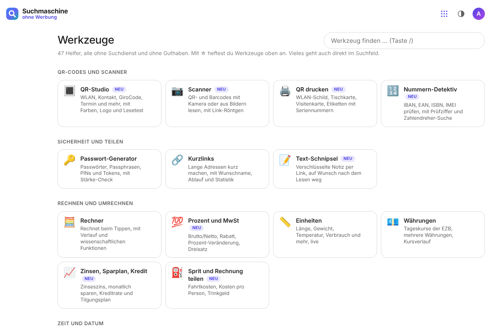</p>

<table>
  <tr>
    <td align="center">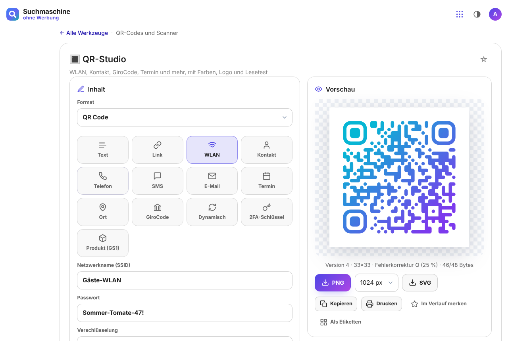<br><sub>QR-Studio mit Design und Lesetest</sub></td>
    <td align="center">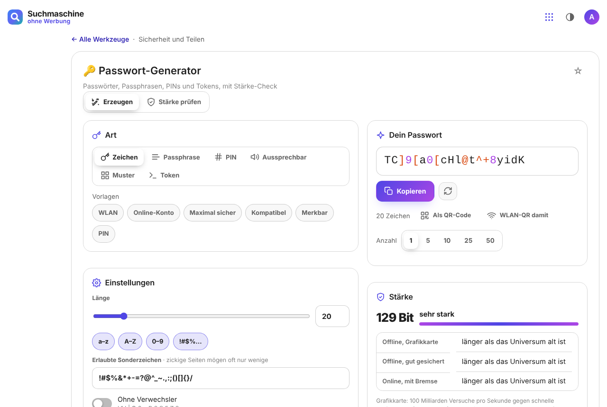<br><sub>Passwort-Generator mit Stärke-Check</sub></td>
  </tr>
  <tr>
    <td align="center">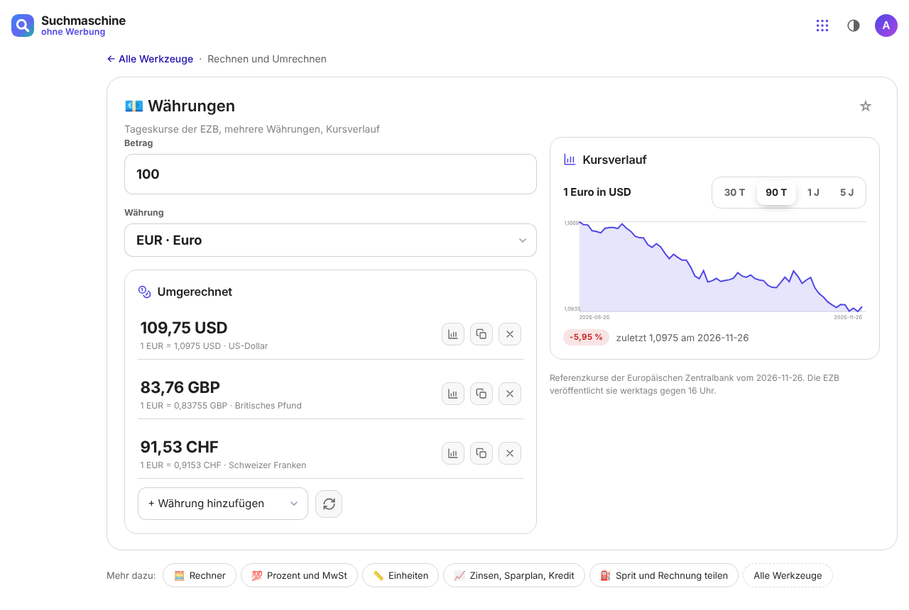<br><sub>Währungen mit Kursverlauf der EZB</sub></td>
    <td align="center">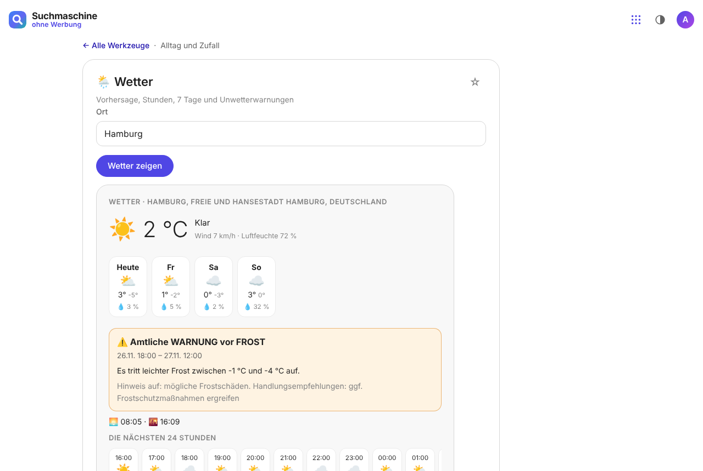<br><sub>Wetter mit Stunden, 7 Tagen und DWD-Warnungen</sub></td>
  </tr>
</table>

**Übersicht:** Werkzeug-Suche (Taste `/`), Favoriten mit ☆, „Zuletzt benutzt“, Abkürzungen im Suchfeld wie `!qr Hallo`, `!pw`, `!kurz https://…`, `!json`, `!dns example.org`.

**QR-Codes und Scanner** (Bausteine aus CodeForge, gleicher Autor)
- **QR-Studio:** Vorlagen für Link, Text, WLAN, Kontakt (vCard), Telefon, SMS, E-Mail, Termin, Ort, **GiroCode**, **2FA-Schlüssel**, Produkt (GS1) und **dynamische QR-Codes** (zeigen auf einen eigenen Kurzlink, das Ziel lässt sich später ändern). Farben, Verläufe, sechs Punktformen, eigene Ecken, **Logo in der Mitte**, Rahmen mit Text. Dazu Data Matrix, Aztec, PDF417 und alle Strichcodes. Export als PNG (bis 4096 px) und SVG.
- **Lesetest:** Jeder Code wird automatisch klein gedruckt, verwischt, schief und dunkel nachgestellt und wieder eingelesen, mit Empfehlung für die Druckgröße.
- **Scanner:** Webcam am PC, Kamera am Handy (mit Taschenlampe, Zoom, Kamerawechsel), Fotos und Screenshots (auch mit Strg+V). QR, Data Matrix, Aztec, PDF417, EAN, UPC, Code 128 und mehr. Serien- und Inventur-Modus mit CSV.
- **Gescanntes direkt suchen:** Kamera-Knopf im Suchfeld, Barcode, ISBN oder Text scannen, und die Suche startet sofort. Im Scanner auf Wunsch mit „Gleich suchen“.
- **Link-Röntgen gegen Quishing:** zeigt die echte Domain, warnt vor nachgemachten Adressen (`pаypal.com` mit kyrillischem a), fremden Markennamen, IP-Adressen und Tricks. Kurzlinks löst der Server auf, ohne die Seite zu öffnen.
- **QR drucken:** Gäste-WLAN-Schild, Tischkarte, Visitenkarte, Spendenschild, Etikettenbögen (Avery, Herma, Etikettendrucker) mit Seriennummern.
- **Nummern-Detektiv:** IBAN, EAN, ISBN, ISSN, PZN, IMEI prüfen, mit Prüfziffer und Hinweis, welche Ziffern vertauscht wurden.

**Sicherheit und Teilen**
- **Passwort-Generator:** zufällige Zeichen, Passphrasen (große deutsche und englische Wortliste), PIN ohne 1234 und Co., aussprechbar, eigenes Muster, Tokens (Hex, Base64url, Base32, UUID). Vorlagen für WLAN, Online-Konto, maximal sicher und zickige Seiten, 50 Stück auf einmal mit CSV, **Stärke-Check** für eigene Passwörter mit Knackzeit und Mustererkennung. Alles nur im Browser.
- **Kurzlinks 2.0** (Ideen aus [ShrinkURL](https://github.com/burnersen/ShrinkURL)): Wunschname, Ablaufdatum, Aufruf-Grenze („nur einmal“), Passwort, Zwischenseite gegen Messenger-Vorschauen, Vorschau mit `+` am Ende, Tracking-Parameter entfernen, Ziel nachträglich ändern, an/aus, **Statistik nur als Zähler pro Tag** (keine IP, kein Cookie), Titel des Ziels, Ziele auf tote Links prüfen, CSV, Lesezeichen-Knopf, Eintrag im Teilen-Menü am Handy.
- **Text-Schnipsel:** im Browser verschlüsselt (AES-256-GCM), der Schlüssel steht nur im Link hinter dem `#`. Gültigkeit, „nach dem Lesen weg“, optional Passwort (ein falsches Passwort verbraucht keinen Abruf).

**Rechnen:** Rechner, der beim Tippen rechnet (Verlauf, wissenschaftlich, Grad/Rad), Prozent und MwSt, Dreisatz, Einheiten live (jetzt auch Verbrauch, Druck, Energie, Leistung, Winkel, Kochen), Währungen mit mehreren Zielen und **Kursverlauf der EZB**, Zinseszins, Sparplan, Kredit mit Tilgungsplan, Spritkosten, Rechnung teilen, römische Zahlen, Morsecode mit Ton und Licht.

**Zeit und Datum:** mehrere Timer gleichzeitig, Pomodoro, Intervall-Training, Wecker, Stoppuhr mit Runden (Timer überleben das Neuladen), Countdown mit Titel, Vollbild und Link, **Arbeitstage mit Feiertagen des Bundeslands**, Wochentag, **Brückentage-Planer**, Feiertage als **Kalenderdatei (.ics)**, Jahreskalender zum Drucken, Weltzeituhr mit Termin-Planer.

**Netz und Web** (nach dem Anmelden, mit sicherem Abruf nach dem Vorbild von [LinkVault](https://github.com/burnersen/LinkVault)): Was Seiten über dich sehen (Kopfzeilen, Browser, WebRTC), Ist die Seite down?, Header und Weiterleitungen mit Sicherheits-Check, SSL-Zertifikat, DNS mit SPF und DMARC, WHOIS über RDAP, Link-Checker für bis zu 200 Links, **Link-Vorschau** (so sieht dein Link in Messengern aus), **Lesezeichen aufräumen** (Doppelte und tote Links aus dem Browser-Export entfernen).

**Für Entwickler:** JSON (formatieren, prüfen, CSV), Kodieren (Base64, URL, HTML, Hex, Binär, Unicode), Hash (SHA-256/512, SHA-1, MD5, CRC32, HMAC, auch von Dateien), JWT-Decoder mit Signaturprüfung, UUID v4/v7, ULID, Nano ID, Regex-Tester, Cron-Erklärer mit den nächsten Läufen, Text vergleichen, Farben mit WCAG-Kontrast, Zahlensysteme, Subnetz-Rechner (IPv4 und IPv6), chmod, `.htpasswd`, Text-Werkzeuge, Unix-Zeitstempel.

**Alltag:** Lotto 6 aus 49, Eurojackpot, Karte ziehen, Ja oder nein, **Wetter mit Stunden, 7 Tagen, UV und amtlichen DWD-Warnungen**.

**Raus:** „Losen und Gruppen bilden“.

**Datenschutz bleibt:** Passwörter, QR-Inhalte, Hashes, JWTs, Regex und Texte verlassen den Browser nicht. Abrufe nach draußen (Netz-Werkzeuge, Link-Röntgen) macht nur dein Server, nur zu öffentlichen Adressen, ohne etwas zu speichern. Die Scan-Engine (zxing-wasm, MIT) liegt auf deinem Server und wird nur geladen, wenn du scannst.

## Neu in 1.5

- **Werkzeuge neu sortiert:** eine Übersicht mit Kacheln nach Gruppen (Rechnen, Zeit und Datum, Zufall, Teilen und Sicherheit, Wetter und Netz), jedes Werkzeug öffnet sich auf einer **eigenen Seite** statt in einer langen Liste. Unten gibt es passende weitere Werkzeuge. Erreichbar überall über das **Kachel-Symbol oben rechts**, auch für Besucher, wenn Suchen ohne Anmeldung erlaubt ist.
- **Einstellungen aufgeräumt:** Login-Token und „Als Standardsuche im Browser“ stehen jetzt zusammen unter **Einstellungen → Browser**. Das Aussehen für alle bearbeitet der Administrator unter **Verwaltung → Aussehen**.
- **API-Keys holen, Schritt für Schritt** direkt in der Verwaltung bei jedem Suchdienst, ohne in die README schauen zu müssen.
- **1.5.1:** Währungskurse einmal am Tag nach der EZB plus Knopf „Kurse jetzt abrufen“. „Meine IP-Adresse“ zeigt auf Wunsch auch die IPv4 bei IPv6-Verbindung (und umgekehrt), am besten über eine eigene IPv4-Subdomain (Verwaltung → Einstellungen), sonst auf Klick über ipify.org. Die Vorschau beim Aussehen bleibt beim Scrollen sichtbar.
- **1.5.2:** Endlos-Scrollen lädt nur noch nach, wenn man unten angekommen ist und bewusst weiterzieht.
- **1.5.3:** „Verbrauch laut Dashboard“ setzt den Zähler eines Suchdienstes genau auf den Stand aus dem Dashboard und zählt von da weiter (für alle Dienste, die ihren Verbrauch nicht selbst melden).
- **1.5.4 und 1.5.5:** Unterschriebene Updates kurz ausprobiert und wieder abgeschaltet. Updates werden über die Prüfsummen kontrolliert, die Unterschrift bleibt freiwillig möglich (siehe [BUILD.md](BUILD.md)).
- Kleinigkeiten: Der Name oben auf der Ergebnisseite wird nicht mehr abgeschnitten, die Währungskarte ist kompakter, Reiter auf dem Handy zeigen, dass man wischen kann. Ist noch kein Suchdienst eingerichtet, kommt der Administrator direkt zur Einrichtung, statt weitergeleitet zu werden.
- **Für Entwickler:** Code nach Themen aufgeteilt, englische Texte in `app/lang/en.php`, automatische Tests, Prüfung bei jedem Push, wiederholbarer Bau, Updates auf Wunsch mit Unterschrift. Für Nutzer bleibt es **eine einzige Installationsdatei**. Wie das zusammengebaut wird: [BUILD.md](BUILD.md).

## Neu in 1.4

### Aussehen nach Wunsch

Unter **Einstellungen → Aussehen** stellt jedes Konto für sich ein, wie die Suchmaschine aussieht. Den Standard für alle legt der Administrator unter **Verwaltung → Aussehen** fest (gilt auch für Besucher ohne Anmeldung).

- **17 fertige Designs**, hell und dunkel. Neben klarem Weiß und Schwarz gibt es gedämpfte Töne für alle, denen Weiß zu grell und Schwarz zu dunkel ist: **Papier**, **Nebel**, **Salbei**, **Schiefer**, **Dämmerung**. Für hell und dunkel jeweils ein Lieblingsdesign, bei „Wie das Gerät“ wird automatisch gewechselt.
- **Farbmischer** (aus „Kaufen“): Hintergrund, Flächen, Schrift, Akzent, dazu freiwillig Titel/Links und Nebentext. Mit Reglern für Farbton, Sättigung und Helligkeit, Farbcode, Live-Vorschau, Warnung bei zu wenig Kontrast und einem Knopf, der die Schriftfarben automatisch abstimmt. Funktioniert auch ohne JavaScript mit den Farbwählern des Browsers.
- **Schriften fest eingebaut:** Atkinson Hyperlegible, Lexend, Source Sans 3, Inter und Literata (mit Serifen). Sie liegen auf deinem eigenen Server, es wird **nichts bei Google** geladen. Alle unter der SIL Open Font License (Lizenzdateien in `app/assets/fonts/`).
- **Größen und Platz:** alles zusammen, Titel der Treffer und Beschreibungen getrennt, Zeilenabstand, Abstand zwischen den Treffern (kompakt bis luftig) und Breite der Trefferliste für große Bildschirme. Auf dem Handy ist die Quellen-Leiste jetzt eine wischbare Zeile.

### Nachladen und News

- **Endlos scrollen oder seitenweise** gilt jetzt für alle Reiter: Alle, Bilder, News und Videos.
- **Nachladen mit Widerstand:** Normales Runterscrollen lädt nichts nach. Erst wer ganz unten angekommen ist und dann bewusst weiterzieht (am Handy ein deutlicher Wisch, am Rechner mehrere Rasten am Mausrad), bekommt die nächsten Treffer. Ein Balken zeigt, wie weit es noch ist, loslassen setzt ihn zurück. Den letzten Eintrag in Ruhe lesen kostet also nichts. Der Knopf „Weitere Treffer“ lädt sofort.
- **Bilder:** 200 auf einmal mit einer einzigen Suche, Blättern und Nachladen kosten danach nichts mehr.
- **News:** Brave holt 50 Meldungen auf einmal, meist der ganze Tag in einer Anfrage. Am Ende geht es mit der letzten Woche weiter. Ältere News hat Brave kaum im Index, die kommen von **Google mit genauem Zeitraum**. Leere Abschnitte gibt es nicht mehr.

## Lesemodus und PDF

Im Menü **⋮** an jedem Treffer steht **„Ohne Werbung lesen“** (nur mit Konto).

- Der eigene Server holt die Seite und schneidet den eigentlichen Inhalt heraus: Werbung, Menüs, Cookie-Banner, Kommentare und Skripte fliegen raus. Angezeigt wird alles in deiner Schrift und deinen Farben.
- **Rezepte** werden über ihre strukturierten Daten erkannt (schema.org), die fast jede Rezeptseite für Suchmaschinen mitliefert: Zutaten, Zubereitung, Zeiten, Bild. Ein Klick schaltet auf den ganzen Artikel mit allen Bildern um.
- Klappt das Herausschneiden nicht (Seiten, die nur mit JavaScript laufen oder Abrufe sperren), gibt es den Knopf **„Über Bright Data versuchen“**, wenn eine Web-Unlocker-Zone eingetragen ist. Das kostet 1 Anfrage bei Bright Data.
- **Als PDF speichern:** mit Live-Vorschau, Schrift (klar oder klassisch), Größe, Zeilenabstand, 1 oder 2 Spalten und Rändern. **Bilder nach Wahl:** Antippen lässt ein Bild weg, so kommt nur ins PDF, was du willst. Das PDF entsteht im Browser, ohne fremde Dienste. Es kann Umlaute, ß und €, aber keine Zeichen außerhalb Westeuropas. Dafür gibt es **Drucken** mit einem sauberen Drucklayout (der Browser kann dort auch „Als PDF sichern“).

**Bitte fair nutzen.** Der Lesemodus ist zum privaten Lesen und Ablegen gedacht (Privatkopie), nicht zum Weiterverbreiten. Darum:
- nur für angemeldete Konten, höchstens 60 Seiten pro Stunde und Konto,
- auf dem Server wird nichts gespeichert, es gibt keine Links, über die andere den Lesemodus aufrufen könnten,
- Bezahlschranken werden nicht umgangen, kostenpflichtige Artikel bleiben beim Anbieter,
- Quelle, Abrufdatum und „nur zum privaten Gebrauch, Rechte beim Urheber“ stehen in der Ansicht und auf jeder PDF-Seite,
- der Abruf gibt sich ehrlich als „Suchmaschine … Lesemodus“ zu erkennen.

Die Rechte an den Inhalten bleiben bei den jeweiligen Seiten. Wer ein PDF weitergibt oder veröffentlicht, ist selbst dafür verantwortlich.

## Neu in 1.3

- **Neueste zuerst** ist Standard bei „Alle“ und bei News. Jedes Konto stellt das unter *Einstellungen → Suche* für sich um, der Administrator legt unter *Verwaltung → Einstellungen* den Standard für alle fest. In der Trefferliste lässt es sich jederzeit über „Sortierung“ umschalten.
- **News aus den letzten 24 Stunden.** Am Ende der Liste geht es automatisch mit der letzten Woche weiter, dann mit dem letzten Monat und dem letzten Jahr. Gibt es gar keine aktuellen News, wird gleich erweitert. Zeitraum und Erweitern sind pro Konto einstellbar.
- **Reset-Datum vom Dienst:** Brave (bei jeder Suche) und Firecrawl (eigene Abfrage, höchstens alle 6 Stunden, kostenlos) melden selbst, wann ihr Kontingent neu startet. Firecrawl und Tavily melden auch ihr Restguthaben. Dafür gibt es ein Feld für Dienste, die das nicht können (seit 1.5.3 **„Verbrauch laut Dashboard“**).
- **Neuer Tab überall:** „Links in neuem Tab öffnen“ gilt für jeden Link nach draußen, auch im Wetter, in der Kurzinfo und in nachgeladenen Treffern.
- **Bangs ohne Aufblitzen:** Die Zwischenseite ist leer und hat die Farbe der Seite. Nur wenn das Ziel hängt, erscheint nach 2 Sekunden ein Knopf „Weiter“.

## Neu in 1.2

### Mehrere Suchdienste, Lastverteilung, Ausweichen

*Seit 2.2 gibt es nur noch Google (über Bright Data) und Brave. Tavily, Exa, parallel.ai und Firecrawl sind raus, alles andere hier gilt weiter.*

- **Automatisch:** Die Suchmaschine fragt den ersten Dienst in deiner Reihenfolge, der noch Guthaben hat und funktioniert. Über jeder Trefferliste steht, wer geliefert hat und warum ein anderer übersprungen wurde.
- **Lastverteilung:** Verbraucht ein Dienst schneller, als sein Kontingent bis zum Reset reicht, gehen Suchen schon vorher an den nächsten. So läuft Brave nicht am 20. leer, sondern alle Kontingente reichen gleichmäßig.
- **Störungen:** Liefert ein Dienst einen Fehler oder ist nicht erreichbar, springt sofort der nächste ein. Der gestörte Dienst pausiert 10 Minuten (bei falschem Key eine Stunde), damit keine Suche auf ihn warten muss. In der Verwaltung siehst du letzten Erfolg, letzten Fehler im Klartext und die durchschnittliche Antwortzeit.
- **Wenn gar nichts mehr geht** (alles aufgebraucht oder gestört), leitet die Suche automatisch an ein Ausweichziel weiter, z. B. Startpage, DuckDuckGo, Mojeek oder eine eigene Adresse mit `{q}`. Die Suche funktioniert also immer.
- **Gezielt ansteuern:** `!brave`, `!tv` (Tavily), `!exa`, `!pa` (parallel.ai), `!fc` (Firecrawl). Oder in der **Quellen-Leiste** über den Treffern einen Dienst anklicken, mit den restlichen Credits daneben.
- **Alle zusammen:** `!multi` (oder `!alle`) fragt mehrere Dienste gleichzeitig, legt doppelte Adressen zusammen und kennzeichnet jeden Treffer mit Badges wie `[Brave]` `[Exa]` `[Tavily]`.
- **Kurzantwort:** Wenn Tavily sucht, kommt eine kurze KI-Antwort mit (ohne Aufpreis, abschaltbar).
- **Wikipedia-Kurzinfo:** Liefert ein Dienst keine Infobox (alle außer Brave), ergänzt die Suchmaschine eine kostenlose Kurzinfo von Wikipedia. So sieht die Seite überall gleich aus.

### Verbrauch, Prognose, Kontingente

- Unter **Verwaltung → Verbrauch** pro Dienst: verbraucht / Limit, Zeitraum, **Reset-Datum mit verbleibenden Tagen**, Verbrauch heute, **Tagesdurchschnitt**, **Hochrechnung bis zum Reset** und ein klares Urteil, ob es reicht (sonst: „reicht nur bis etwa …“). Dazu der Verlauf nach Monaten und der Verbrauch pro Konto.
- **Warnhinweis:** Ab 80 % (einstellbar) oder wenn die Prognose nicht bis zum Reset reicht, sieht der Administrator oben einen Hinweis.
- **Kontingente pro Konto:** Unter *Verwaltung → Konten → Kontingent* legst du fest, welche Dienste ein Konto nutzen darf und wie viele Credits es pro Zeitraum bekommt. „Gerecht aufteilen“ verteilt die Limits gleichmäßig auf alle Konten.

### Sofort-Antworten (kosten kein Guthaben)

Direkt im Suchfeld, beantwortet bevor ein Suchdienst gefragt wird. Unter jeder Antwort steht „Trotzdem im Web suchen“.

| Eingabe | Ergebnis |
|---|---|
| `(12,5 + 7) * 3`, `200 + 19%`, `15% von 80`, `2^10`, `sqrt 2` | Taschenrechner (eigener Parser, kein `eval`), Komma und Punkt |
| `100 usd in eur`, `50 chf in eur`, `20 € in £` | Währungen, Kurse der EZB über frankfurter.app, einmal am Tag gespeichert |
| `10 km in meilen`, `20 °c in f`, `1 gib in mb`, `100 km/h in mph` | Einheiten: Länge, Gewicht, Temperatur, Daten, Volumen, Fläche, Tempo, Zeit |
| `wetter berlin`, `wetter` | Wetter mit 4-Tage-Vorhersage: Deutscher Wetterdienst über Bright Sky, Open-Meteo (DWD-Modell ICON) oder wttr.in, alle kostenlos |
| `meine ip` | eigene IP-Adresse |
| `kw`, `kw 12`, `kw 1 2027` | Kalenderwoche samt Datumsspanne |
| `datum`, `uhrzeit` | Datum, Uhrzeit, Tag des Jahres |
| `würfel`, `2w20`, `münze`, `zufallszahl 1-49` | Würfel, Münzwurf, Zufallszahl |
| `timer 5 min`, `stoppuhr`, `countdown weihnachten` | Timer mit Ton, Stoppuhr, Countdown |
| `passwort`, `passwort 32`, `passphrase` | Passwort-Generator, läuft nur im Browser |
| `qr https://…` | QR-Code als SVG, auf dem eigenen Server erzeugt |
| `kurz https://…` | eigener Kurzlink (`…/?s=abc123`) |
| `tage zwischen 1.1.2026 und 24.12.2026`, `heute + 6 wochen` | Datumsrechner mit Wochen und Werktagen |
| `alter 12.05.1940` | Alter, nächster Geburtstag, Tage auf der Welt |
| `feiertage 2027 bayern`, `feiertage nrw` | gesetzliche Feiertage nach Bundesland |
| `arbeitstage zwischen 1.12.2026 und 31.12.2026 bayern`, `heute + 10 arbeitstage` | Arbeitstage mit den Feiertagen des Bundeslands |
| `wochentag 24.12.2027` | Wochentag, Kalenderwoche, Tag des Jahres |
| `brückentage 2027 nrw` | Brückentage-Planer: wenig Urlaub, viele freie Tage |
| `jahreskalender 2027`, `kalender 2027` | Jahreskalender mit KW und Feiertagen, zum Drucken |
| `lotto`, `eurojackpot`, `karte ziehen`, `ja oder nein` | Lottozahlen, Spielkarte, Entscheidungshilfe |
| `!qr Hallo`, `!pw`, `!kurz https://…`, `!scan`, `!json`, `!dns example.org` | öffnet das passende Werkzeug |

### Werkzeuge

Unter **Werkzeuge** (Kachel-Symbol oben rechts, Konto-Menü oder Startseite) stehen 47 Helfer an einem Ort, nach Gruppen sortiert, mit Suche, Favoriten und „Zuletzt benutzt“. Jedes Werkzeug hat eine eigene Seite. Nichts davon fragt einen Suchdienst, kostet also kein Guthaben. Was alles dabei ist, steht oben unter [Neu in 2.0](#neu-in-20-das-große-werkzeug-upgrade).

- **QR-Codes und Scanner:** QR-Studio, Scanner (auch direkt aus dem Suchfeld), QR drucken, Nummern-Detektiv
- **Sicherheit und Teilen:** Passwort-Generator, Kurzlinks, verschlüsselte Text-Schnipsel
- **Rechnen und Umrechnen:** Rechner, Prozent und MwSt, Einheiten, Währungen, Zinsen, Sprit und Rechnung teilen
- **Zeit und Datum:** Timer und Stoppuhr, Countdown, Datumsrechner, Feiertage und Brückentage, Kalender, Weltzeituhr
- **Netz und Web:** Meine IP, Ist die Seite down?, Header, SSL, DNS, WHOIS, Link-Checker, Link-Vorschau, Lesezeichen aufräumen
- **Für Entwickler:** JSON, Kodieren, Hash, JWT, UUID, Regex, Cron, Text vergleichen, Farben, Zahlensysteme, Subnetz, chmod, .htpasswd, Text-Werkzeuge, Zeitstempel
- **Alltag und Zufall:** Würfel, Münze, Lotto, Wetter, Römische Zahlen, Morsecode

Die einfachen Rechen- und Datumswerkzeuge funktionieren auch ohne JavaScript. Die Apps (QR-Studio, Scanner, Passwörter, Entwickler-Werkzeuge …) brauchen JavaScript, weil sie bewusst nur im Browser rechnen. Die Netz-Werkzeuge rufen fremde Server ab und sind darum nur nach dem Anmelden da.

**Töne:** Für den Timer gibt es sechs Töne (Glocke, Gong, Ding-Dong, sanfte Tonfolge, Vogelzwitschern, Wecker) mit „Ton testen“. Sie sind rein rechnerisch erzeugt, ohne fremde Aufnahmen, und liegen als MP3 in `app/assets/sounds/`. Frei verwendbar (CC0), auch in anderen Projekten.

### Filter, Sortierung, Ergebnis-Menü

- **Nach Datum sortieren (neueste zuerst):** streng chronologisch, Treffer ohne Datum ans Ende. Bei aktivem Zeitfilter automatisch.
- **Max. 3 Treffer pro Domain:** Schalter in der Filterleiste, standardmäßig an.
- **„Alle Filter zurücksetzen“** erscheint, sobald ein Filter vom Standard abweicht.
- **×** im Suchfeld zum Leeren, auf dem Handy extra groß.
- **Menü ⋮** an jedem Treffer: *Nur auf dieser Domain suchen* (`site:`), *Archiv* bei web.archive.org und archive.today, *Als QR-Code anzeigen*, *Adresse kopieren*, mit Konto dazu hoch-/herabstufen/blockieren.

### Bilder

- **Filter wie bei Google:** Ausrichtung (Quer, Hoch, Quadratisch) und Größe (Sehr groß ab 1 MP, Groß ab 0,3 MP, Mittel, Klein unter 0,15 MP), nach den Maßen, die Brave liefert.
- **Sortierung nach Auflösung** (Breite × Höhe, höchste zuerst).
- **Vollbild** zeigt jedes Bild immer ganz: zentriert auf Schwarz, höchstens so groß wie der Bildschirm, nie beschnitten.

### Komplettsicherung

Unter **Verwaltung → Sicherung**: eine Datei mit allem (Einstellungen, alle API-Keys, Konten mit Passwort-Prüfsummen, Login-Tokens, persönliche Einstellungen, Kontingente, Kurzlinks, Verbrauch, Logo). **Auf Wunsch mit Passwort verschlüsselt** (AES-256-GCM, Schlüssel per PBKDF2 aus dem Passwort). Einspielen geht an gleicher Stelle, danach melden sich alle neu an.

## Konten und Token-Login

- **Erstes Konto:** Wer die Suchmaschine zuerst aufruft, legt das Administrator-Konto an. Der Brave-Key ist dabei freiwillig, Keys lassen sich auch später unter *Verwaltung → Suchdienste* eintragen.
- **Weitere Konten** legt der Administrator unter *Verwaltung → Konten* an, auf Wunsch mit eigenem Kontingent.
- **Login-Token:** Unter *Einstellungen → Browser* erzeugt jedes Konto einen langen geheimen Token (48 Zeichen) oder legt einen eigenen fest (mindestens 32 Zeichen, mindestens drei Zeichenarten). Token, Login-Adresse und Such-Adresse lassen sich dort anzeigen, kopieren und neu erzeugen, natürlich nur angemeldet.
- **So funktioniert's:** `https://deine-domain.de/suche/?token=DEIN_TOKEN` (auch kombiniert: `?token=…&q=…`) meldet sofort an und setzt ein Sitzungs-Cookie für **365 Tage** (`HttpOnly`, `Secure` bei HTTPS, `SameSite=Lax`). Der Token verschwindet dabei sofort per Weiterleitung aus der Adresse. Die Sitzung liegt serverseitig (im Cookie steht nur ein Zufallswert, in der Datenbank nur dessen Prüfsumme), lässt sich also jederzeit beenden: Abmelden, Cookies löschen oder *Alle anderen Geräte abmelden*.
- **Als Standardsuche im Browser:** die Such-Adresse mit Token eintragen (`…/?token=…&q=%s`) oder in Firefox auf der Konto-Seite über das Lupen-Symbol hinzufügen (OpenSearch mit Token). Dann bleibt der Browser auch in privaten Fenstern angemeldet.
- **Sicherheit:** Falsche Tokens werden gebremst (nach 5 Fehlversuchen wachsende Wartezeit), verglichen wird in konstanter Zeit. Der Token liegt verschlüsselt in der Datenbank, der Schlüssel dazu in `data/config.php`. Ein Token ist wie ein Passwort: nur auf eigenen Geräten nutzen. Achtung, Webserver-Logs können Adressen mit Token mitschreiben.

## Tastenkürzel

Auf der Ergebnisseite, sobald kein Eingabefeld aktiv ist:

| Taste | Wirkung |
|---|---|
| `↓` / `J`, `↑` / `K` | durch die Treffer, mit sichtbarem Rahmen |
| `Enter` | markierten Treffer öffnen, mit `Strg`/`⌘` im neuen Tab |
| `←` `→` | vorige/nächste Ergebnisseite, in der Bildvorschau blättern |
| `/` | Suchfeld fokussieren und markieren |
| `F` | Bildvorschau im Vollbild |
| `?` | Übersicht aller Kürzel (deutsche Tastatur: `Shift` + `ß`) |
| `Esc` | Übersicht, Menüs, Bildvorschau, Vollbild schließen |

## Voraussetzungen

- Webspace mit **PHP 8.0 oder neuer**, dazu die Erweiterungen `pdo_sqlite` und `curl`. Das hat praktisch jeder Hoster.
- Der Server muss Verbindungen nach außen aufbauen dürfen: zu den Such-APIs (`api.brightdata.com`, `api.search.brave.com`), zu `www.google.com` (Weiterleitungs-Links auflösen) und `*.gstatic.com` (Googles Vorschaubilder), für Sofort-Antworten zu `api.frankfurter.dev`, `geocoding-api.open-meteo.com`, `api.brightsky.dev`, `api.open-meteo.com`, `wttr.in`, `*.wikipedia.org` und für Updates zu `github.com`.
- Für die verschlüsselte Sicherung und das verschlüsselte Speichern der Login-Tokens die Erweiterung `openssl` (fast immer vorhanden).
- **HTTPS.** Ohne geht das Passwort im Klartext durchs Netz. Bei den meisten Hostern ist ein kostenloses Let's-Encrypt-Zertifikat mit einem Klick eingerichtet.
- **Apache** (oder LiteSpeed) sperrt die internen Ordner von selbst über `.htaccess`. Unter **nginx** sind zwei Zeilen in der Konfiguration nötig, siehe [Daten schützen](#daten-schützen).
- Mindestens ein **API-Key** eines Suchdienstes (kostenlos, siehe [Suchdienste einrichten](#suchdienste-einrichten-api-keys-holen)).

## Installation

1. **API-Keys holen**, siehe [Suchdienste einrichten](#suchdienste-einrichten-api-keys-holen). Einer reicht für den Anfang.
2. Aus dem [neuesten Release](../../releases/latest) die Datei **`suchmaschine-install.php`** herunterladen und per FTP oder Dateimanager in ein Verzeichnis auf dem Webspace kopieren, z. B. `httpdocs/suche/`. Soll die Suchmaschine direkt unter der Domain laufen, kommt die Datei direkt nach `httpdocs/`.
3. Die Datei **sofort** im Browser aufrufen, z. B. `https://deine-domain.de/suche/suchmaschine-install.php`, und auf **„Jetzt installieren“** klicken. Sie packt das Programm aus, löscht sich selbst und leitet weiter. Meldet sie, dass sie sich nicht löschen konnte, die Datei bitte von Hand löschen.
4. Gleich danach **Konto anlegen** und optional den **Brave-Key einfügen**. Der Key wird mit einer Testsuche geprüft. Dieses Konto ist der Administrator. Nicht aufschieben: Wer zuerst kommt, wird Administrator. Google über Bright Data (5.000 Anfragen im Monat kostenlos) trägst du danach unter *Verwaltung → Suchdienste* ein.
5. **Test:** In der Verwaltung unter *Update → Schutz der Daten* auf „Jetzt prüfen“ klicken. Dort muss „Alles dicht“ stehen. Von Hand geht es so: `https://deine-domain.de/suche/app/lib/db.php` aufrufen, da muss **403** oder **404** kommen.

<p align="center"></p>

Wer lieber von Hand installiert: Das ZIP aus dem Release entpacken und den Inhalt des Ordners `suchmaschine/` hochladen.

### Netcup und andere Hoster mit Plesk

Bei vielen Hostern läuft vor Apache ein **nginx**, der Dateien direkt ausliefert und dabei die `.htaccess` übergeht. Dann öffnen: **„Apache & nginx-Einstellungen“** der Domain und **„Statische Dateien direkt durch nginx bereitstellen“** bzw. **„Intelligente Verarbeitung statischer Dateien“** ausschalten. Danach greift die Sperre der internen Ordner. Der Selbsttest in der Verwaltung zeigt, ob alles dicht ist.

Selbst wenn die Sperre nicht greift, bleibt das Wichtigste geschützt: Die Datenbank hat einen zufälligen Namen, der nur in einer `.php`-Datei steht, und `.php`-Dateien kann man von außen nicht herunterladen.

## Daten schützen

**1. Die internen Ordner sperren.** Unter Apache legt die Suchmaschine die nötigen `.htaccess`-Dateien selbst an. Unter **nginx** mit eigener Konfiguration gehören diese zwei Zeilen in den `server`-Block. Das `^~` ist wichtig, es gibt der Sperre Vorrang vor der Regel für `.php`-Dateien. Liegt die Suchmaschine in einem Unterordner, den Pfad anpassen, z. B. `/suche/data/`:

```nginx
location ^~ /data/ { deny all; return 404; }
location ^~ /app/  { deny all; return 404; }
```

Mit Sicherung vorher und Weg zurück:

```bash
# Sicherung der Konfiguration (Pfad je nach System, oft /etc/nginx/sites-available/)
sudo cp -a /etc/nginx/sites-available/default /etc/nginx/sites-available/default.bak
# Die zwei Zeilen oben in den server-Block eintragen, dann prüfen und neu laden:
sudo nano /etc/nginx/sites-available/default
sudo nginx -t && sudo systemctl reload nginx
# Falls etwas nicht stimmt, zurückholen:
sudo cp -a /etc/nginx/sites-available/default.bak /etc/nginx/sites-available/default && sudo systemctl reload nginx
```

**2. HTTPS einschalten** und am besten auf HTTPS umleiten.

**3. Den Ordner `data/` nie veröffentlichen oder ins Git legen.** Dort liegen Konten, Einstellungen, alle API-Keys und der Schlüssel für die Login-Tokens.

## Aktualisieren

**Am einfachsten in der Verwaltung** unter *Update*: „Nach Updates suchen“ und dann „Jetzt aktualisieren“. Dafür muss PHP die Programmdateien überschreiben dürfen. Die laufende Version wird vorher gesichert, „Zurück zu …“ holt sie wieder. Wer gar keine Verbindung zu GitHub möchte, trägt in `data/config.php` den Eintrag `'update_url' => ''` ein.

Von Hand: den neuen `suchmaschine-install.php` hochladen und aufrufen. Ersetzt werden nur die Programmdateien, der Ordner `data/` bleibt unangetastet.

## Sichern

Alles, was zählt, liegt im Ordner **`data/`**: Konten, Einstellungen, API-Keys, eigenes Logo. Diesen Ordner per FTP herunterladen, fertig. Zum Zurückholen den Ordner wieder hochladen.

Ohne FTP geht es im Browser:
- **Komplettsicherung** unter *Verwaltung → Sicherung*: alles in einer Datei, auf Wunsch mit Passwort verschlüsselt. Ideal für einen Umzug.
- **Nur die Einstellungen der Installation** (auf Wunsch mit API-Keys), ebenfalls unter *Verwaltung → Sicherung*.
- **Persönliche Einstellungen** jedes Kontos (Suche, Domain-Listen, Bangs, Linsen) unter *Einstellungen → Konto*.

Alles lässt sich an derselben Stelle wieder einspielen.

## Aufbau

```
index.php      Einstieg: Version, Pfade, lädt app/lib/ und startet den Ablauf
app/lib/       Funktionen, eine Datei pro Thema: Ablauf (router.php), Seiten (page_*.php), Datenbank, Konten,
               Suchdienste (providers.php, brave.php), Filter, Domain-Listen, Bangs und Linsen, Sofort-Antworten (instant.php),
               QR-Codes, Bild-Proxy, Lesemodus, Aussehen, Logo, Sicherung, Update,
               Werkzeuge (page_tools.php, tools_api.php), sicherer Abruf nach draußen (net.php), Kurzlinks und Schnipsel
app/lang/      englische Texte (en.php)
app/views/     HTML-Vorlagen
app/assets/    CSS, JavaScript, PDF-Baukasten (pdf.js), Symbole, Schriften, Töne (werden über index.php ausgeliefert)
  cf/          Bausteine der Werkzeug-Apps aus CodeForge: QR-Encoder, Zeichnen, Scanner, Druck, Nummern-Detektiv
  tools/       eigene Werkzeug-Apps (Passwörter, Kurzlinks, Netz, Entwickler, Rechnen, Zeit) und englische Texte (en.js)
  vendor/      Scan-Engine zxing-wasm (MIT), wird nur beim Scannen geladen
data/          entsteht beim ersten Aufruf: Datenbank, Einstellungen, Logo (geheim!)
tests/         automatische Tests
tools/         Release bauen, Texte der Apps prüfen (nur für Entwickler)
```

Die Dateien in `app/` tun nichts, wenn man sie direkt aufruft, alles läuft über `index.php`. Eine ausführliche Übersicht, welche Datei wofür zuständig ist, steht in [BUILD.md](BUILD.md#wo-was-im-quellcode-steht).

## Selbst bauen

Im Quellcode ist das Programm auf viele Dateien verteilt, Nutzer bekommen trotzdem nur **eine Datei**. Bauen kann sie jeder selbst, nur mit PHP:

```sh
php tools/build-release.php
```

Das prüft die Syntax, lässt alle Tests laufen, baut `dist/suchmaschine-install.php`, installiert sie zur Probe und schreibt Prüfsummen. Der Bau ist wiederholbar: Gleicher Quellcode ergibt dieselbe Datei, so lässt sich jedes Release mit dem Quellcode vergleichen. Alle Einzelheiten, auch zur Unterschrift der Updates: [BUILD.md](BUILD.md). Mitmachen: [CONTRIBUTING.md](CONTRIBUTING.md), Sicherheitslücken melden: [SECURITY.md](SECURITY.md).

## Gut zu wissen

- **Datenschutz:** Die Suchdienste sehen die Suchbegriffe, aber nicht, wer sucht, denn die Anfrage kommt von deinem Server. Gezählt wird nur die Menge der Anfragen pro Konto, nie ihr Inhalt. Die Suchmaschine selbst speichert keine Suchbegriffe, nur kurz im Zwischenspeicher. Die letzten Suchen für die Vorschläge bleiben im Browser des jeweiligen Geräts. Vorschaubilder und Symbole lädt der Browser über Braves Bild-Proxy.
- **Bilder in voller Auflösung:** Für die große Vorschau holt der Server das Originalbild und reicht es weiter. Die fremde Seite sieht nur den Server, der Browser lädt weiter nur von der eigenen Adresse. Gegen Missbrauch ist jede Bildadresse signiert, interne Netze sind gesperrt, gespeichert wird nichts. Kostet keine Suche, nur etwas Datenverkehr, und lässt sich in der Verwaltung abschalten.
- **Suchoperatoren** gibt die Suchmaschine unverändert an den Suchdienst weiter. Brave versteht die meisten, die anderen Dienste vor allem Anführungszeichen und `site:`. Klammern kennt Brave nicht.
- **Mehrere Personen:** Konten für Familie oder Freunde sind schnell angelegt. Alle Suchen gehen vom selben Guthaben ab. Mit Kontingenten pro Konto teilst du es auf.
- **Suchen ohne Anmeldung** lässt sich einschalten, etwa fürs Heimnetz. Jede Suche kostet dann dein Guthaben. Die Grenze pro Stunde und Besucher bremst Missbrauch, das Monatslimit gilt trotzdem.
- **Endlos scrollen:** Jedes Nachladen ist eine echte Suche bei Brave. Darum holt die Suchmaschine dabei 20 Treffer auf einmal. Brave liefert pro Suchbegriff höchstens 10 Seiten.
- **Bedingungen der Anbieter:** Ergebnisse dürfen nicht weiterverkauft werden, Brave erlaubt nur kurzes Zwischenspeichern. Ein Hinweis auf die genutzten Dienste steht unten auf jeder Seite.
- **Wetter, Wechselkurse, Wikipedia:** Diese kostenlosen Dienste fragt nur der Server, mit Zwischenspeicher (Kurse 12 Stunden, Wetter 20 bis 30 Minuten, Wikipedia einen Tag).

## Sicherheit

Die Suchmaschine wurde für 1.2 aus Angreifersicht geprüft und gehärtet:

- **XSS:** Jede Ausgabe wird escaped, Texte der Suchdienste nur mit `<strong>` als Ausnahme. Strenge Content Security Policy ohne Inline-Skripte, QR-Codes, Logos und Bilder aus dem Proxy kommen mit eigener Sandbox-CSP.
- **CSRF:** Jedes Formular braucht das Sitzungs-Token und muss von der eigenen Seite kommen. Der Token-Login funktioniert nur direkt (Adressleiste, Lesezeichen, Browser-Suche), nicht über Links fremder Seiten, und wechselt nie stillschweigend das Konto.
- **SQL-Injection:** ausschließlich vorbereitete Abfragen. Wiederherstellungen werden Feld für Feld geprüft.
- **SSRF:** Der Bild-Proxy lädt nur signierte Adressen, nur öffentliche IPs (DNS fest verdrahtet, jede Weiterleitung neu geprüft), nur echte Bilder. Wetter, Kurse und Wikipedia gehen nur an fest eingebaute HTTPS-Adressen, ohne Weiterleitungen.
- **Brute-Force und Timing:** Passwort- und Token-Login werden nach Fehlversuchen gebremst, Vergleiche laufen mit `hash_equals()` bzw. `password_verify()` in konstanter Zeit.
- **Rechner:** eigener Parser, kein `eval`, Grenzen für Länge, Tiefe und Exponenten.
- **Path Traversal:** feste Dateinamen, Updates nur mit Prüfsumme und erlaubten Pfaden.
- **Geheimnisse:** Login-Tokens liegen verschlüsselt in der Datenbank, der Schlüssel in `data/config.php`. Weiterleitungen mit Token werden nicht zwischengespeichert. Sitzungen liegen auf dem Server und lassen sich jederzeit beenden.
- **Missbrauch ohne Anmeldung:** Wetter zählt zur Stundengrenze, „Alle zusammen“ gibt es nur mit Konto.

## Haftungsausschluss

Die Suchmaschine ist kostenlose Hobby-Software und wird **so, wie sie ist, ohne jede Gewähr** bereitgestellt. Sie ist mit Sorgfalt gebaut und getestet, die Nutzung erfolgt aber **auf eigene Gefahr**. Wer sie betreibt, ist für den Server, seine Updates und Sicherungen selbst verantwortlich, ebenso dafür, die Bedingungen der genutzten Anbieter einzuhalten. Dieses Projekt steht in keiner Verbindung zu Brave Software, Bright Data oder Google.

## Lizenz

GNU Affero General Public License v3.0, siehe [LICENSE](LICENSE).

Eingebaut seit 2.0: Scan-Engine [zxing-wasm](https://github.com/Sec-ant/zxing-wasm) (MIT) mit zxing-cpp (Apache 2.0), Details in `app/assets/vendor/LIZENZEN.txt`. Wortlisten für Passphrasen: Deutsch aus [dys2p/wordlists-de](https://github.com/dys2p/wordlists-de) (CC0), Englisch aus den Wortlisten der [EFF](https://www.eff.org/deeplinks/2016/07/new-wordlists-random-passphrases) (CC BY 3.0 US). Symbole im Stil von Lucide (ISC). Bang-Liste aus [kagisearch/bangs](https://github.com/kagisearch/bangs) (MIT), Lizenz in `app/lists/LIESMICH.txt`.
