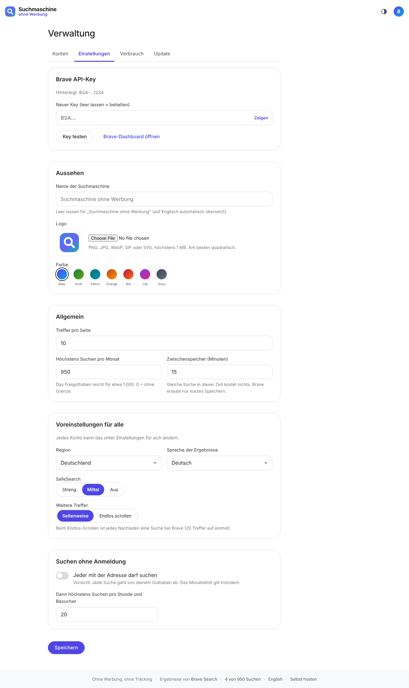
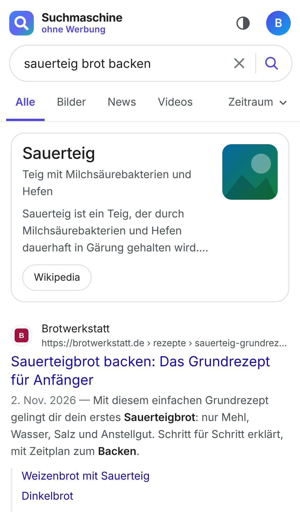
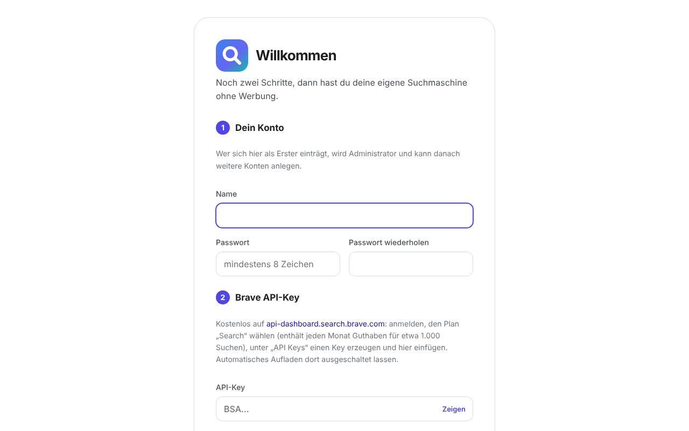

<p align="center"></p>

<h1 align="center">Suchmaschine ohne Werbung</h1>

<p align="center"><b>Deine eigene Suchmaschine. Ohne Werbung, ohne Tracking, auf deinem eigenen Webspace.</b><br>
Ergebnisse von Brave Search, bei normaler privater Nutzung im kostenlosen Monatsguthaben.</p>

<p align="center"><a href="README.en.md">English version</a> · <a href="../../releases/latest">Neueste Version herunterladen</a></p>

<p align="center"></p>

Einfach `suchmaschine-install.php` hochladen, im Browser aufrufen, Konto anlegen, Brave-Key einfügen. Das ist die ganze Installation.

Auf dem Server laufen PHP und SQLite, im Browser schlichtes JavaScript und CSS. Keine Frameworks, keine Abhängigkeiten, kein Build-Schritt, keine MySQL-Datenbank. Läuft auf ganz normalem Shared Webhosting.

## Bilder

<table>
  <tr>
    <td align="center"><br><sub>Startseite</sub></td>
    <td align="center"><br><sub>Dunkles Design</sub></td>
  </tr>
  <tr>
    <td align="center"><br><sub>Bildersuche</sub></td>
    <td align="center"><br><sub>Bildvorschau</sub></td>
  </tr>
  <tr>
    <td align="center"><br><sub>News</sub></td>
    <td align="center"><br><sub>Videos</sub></td>
  </tr>
  <tr>
    <td align="center"><br><sub>Ähnliche Fragen</sub></td>
    <td align="center"><br><sub>Vorschläge aus den eigenen letzten Suchen</sub></td>
  </tr>
  <tr>
    <td align="center"><br><sub>Verwaltung: Key, Name, Logo, Farbe</sub></td>
    <td align="center"><br><sub>Verwaltung: Konten</sub></td>
  </tr>
</table>

<p align="center">
  
  
  
</p>

[Kosten](#was-kostet-das) · [Funktionen](#funktionen) · [Voraussetzungen](#voraussetzungen) · [Installation](#installation) · [Daten schützen](#daten-schützen) · [Aktualisieren](#aktualisieren) · [Sichern](#sichern) · [Aufbau](#aufbau) · [Gut zu wissen](#gut-zu-wissen) · [Lizenz](#lizenz)

## Was kostet das?

Bei normaler privater Nutzung nichts. Die Ergebnisse kommen über die [Brave Search API](https://brave.com/search/api/):

- Der Plan **„Search“** enthält jeden Monat **5 $ Guthaben**. Eine Suche kostet 0,5 Cent, das reicht also für **etwa 1.000 Suchen im Monat**.
- Brave möchte zur Anmeldung eine **Kreditkarte** sehen, gegen Missbrauch. Abgerechnet wird über Guthaben ohne Abo. Lass im Brave-Dashboard die **automatische Aufladung ausgeschaltet**, dann wird nichts abgebucht.
- Die Suchmaschine hat ein eigenes **Monatslimit** (Standard 950). Ist es erreicht, pausiert sie bis zum Monatsersten. So kommst du nicht aus Versehen über das Freiguthaben.
- Ein **Zwischenspeicher** (Standard 15 Minuten) sorgt dafür, dass Neuladen, Zurück-Knopf und Blättern keine zusätzlichen Suchen kosten. Länger speichert die Suchmaschine nichts, weil Braves Bedingungen nur kurzes Zwischenspeichern erlauben.

Zum Vergleich: Wer 10 Mal am Tag sucht, kommt auf rund 300 Suchen im Monat.

## Funktionen

- **Web, Bilder, News, Videos** in Reitern, wie man es kennt.
- **Gemischte Ergebnisse** wie bei den großen Suchmaschinen: Top-Meldungen, Videos, „Ähnliche Fragen“ und Diskussionen aus Foren erscheinen zwischen den Treffern, dazu eine **Kurzinfo** am Rand (z. B. aus Wikipedia). Was Brave zu einer Suche liefert, wird angezeigt.
- **Seitenweise oder endlos scrollen**, für jedes Konto einstellbar.
- **Zeitraum-Filter** (24 Stunden, Woche, Monat, Jahr), **Rechtschreibkorrektur** mit „Stattdessen suchen nach …“, **„Auf gut Glück“**.
- **Bildvorschau** im Großformat mit Pfeiltasten zum Blättern.
- **Vorschläge aus den eigenen letzten Suchen.** Die bleiben nur im Browser, der Server merkt sich nichts.
- **Hell und dunkel**, automatisch nach dem Gerät oder per Knopf.
- **Deutsch und Englisch**, je nach Browser, umschaltbar unten auf der Seite.
- **Für Handy und Rechner**, lässt sich auch als App auf den Startbildschirm legen.
- **Als Standardsuche im Browser** eintragbar (OpenSearch), z. B. in Firefox mit einem Klick.
- **Konten:** Wer sich als Erster einträgt, wird Administrator und kann weitere Konten anlegen, etwa für die Familie. Jedes Konto hat eigene Einstellungen (Region, Sprache, SafeSearch, neuer Tab, Seiten oder endlos).
- **Verwaltung** für den Administrator: API-Key mit Test, Name der Suchmaschine, **eigenes Logo**, **Farbe**, Voreinstellungen für alle, Monatslimit, Verbrauch pro Monat, auf Wunsch Suchen ohne Anmeldung (mit Grenze pro Stunde).
- **Updates per Knopfdruck:** Die Suchmaschine schaut beim neuesten Release auf GitHub nach, prüft die Datei per Prüfsumme, sichert die laufende Version und spielt die neue ein. Zurück zur vorigen Version geht mit einem Klick. Auf Wunsch einmal am Tag automatisch.
- **Selbsttest:** Die Verwaltung prüft, ob die internen Ordner von außen wirklich gesperrt sind, und warnt sonst.
- **Ohne Werbung, ohne Tracking, ohne fremde Skripte.** Strenge Sicherheitsregeln (Content Security Policy), Links öffnen ohne Referrer, Vorschaubilder kommen über Braves Bild-Proxy.

## Voraussetzungen

- Webspace mit **PHP 8.0 oder neuer**, dazu die Erweiterungen `pdo_sqlite` und `curl`. Das hat praktisch jeder Hoster.
- Der Server muss Verbindungen nach außen aufbauen dürfen (zu `api.search.brave.com`, für Updates zu `github.com`).
- **HTTPS.** Ohne geht das Passwort im Klartext durchs Netz. Bei den meisten Hostern ist ein kostenloses Let's-Encrypt-Zertifikat mit einem Klick eingerichtet.
- **Apache** (oder LiteSpeed) sperrt die internen Ordner von selbst über `.htaccess`. Unter **nginx** sind zwei Zeilen in der Konfiguration nötig, siehe [Daten schützen](#daten-schützen).
- Ein **Brave Search API-Key** (kostenlos, siehe oben).

## Installation

1. **Brave-Key holen:** Auf [api-dashboard.search.brave.com](https://api-dashboard.search.brave.com) anmelden, den Plan **„Search“** wählen, Kreditkarte hinterlegen, die **automatische Aufladung ausgeschaltet lassen**, unter **„API Keys“** einen Key erzeugen.
2. Aus dem [neuesten Release](../../releases/latest) die Datei **`suchmaschine-install.php`** herunterladen und per FTP oder Dateimanager in ein Verzeichnis auf dem Webspace kopieren, z. B. `httpdocs/suche/`. Soll die Suchmaschine direkt unter der Domain laufen, kommt die Datei direkt nach `httpdocs/`.
3. Die Datei **sofort** im Browser aufrufen, z. B. `https://deine-domain.de/suche/suchmaschine-install.php`, und auf **„Jetzt installieren“** klicken. Sie packt das Programm aus, löscht sich selbst und leitet weiter. Meldet sie, dass sie sich nicht löschen konnte, die Datei bitte von Hand löschen.
4. Gleich danach **Konto anlegen** und den **Brave-Key einfügen**. Der Key wird mit einer Testsuche geprüft. Dieses Konto ist der Administrator. Nicht aufschieben: Wer zuerst kommt, wird Administrator.
5. **Test:** In der Verwaltung unter *Update → Schutz der Daten* auf „Jetzt prüfen“ klicken. Dort muss „Alles dicht“ stehen. Von Hand geht es so: `https://deine-domain.de/suche/app/lib/db.php` aufrufen, da muss **403** oder **404** kommen.

<p align="center"></p>

Wer lieber von Hand installiert: Das ZIP aus dem Release entpacken und den Inhalt des Ordners `suchmaschine/` hochladen.

### Netcup und andere Hoster mit Plesk

Bei vielen Hostern läuft vor Apache ein **nginx**, der Dateien direkt ausliefert und dabei die `.htaccess` übergeht. Dann öffnen: **„Apache & nginx-Einstellungen“** der Domain und **„Statische Dateien direkt durch nginx bereitstellen“** bzw. **„Intelligente Verarbeitung statischer Dateien“** ausschalten. Danach greift die Sperre der internen Ordner. Der Selbsttest in der Verwaltung zeigt, ob alles dicht ist.

Selbst wenn die Sperre nicht greift, bleibt das Wichtigste geschützt: Die Datenbank hat einen zufälligen Namen, der nur in einer `.php`-Datei steht, und `.php`-Dateien kann man von außen nicht herunterladen.

## Daten schützen

**1. Die internen Ordner sperren.** Unter Apache legt die Suchmaschine die nötigen `.htaccess`-Dateien selbst an. Unter **nginx** mit eigener Konfiguration gehören diese zwei Zeilen in den `server`-Block. Das `^~` ist wichtig, es gibt der Sperre Vorrang vor der Regel für `.php`-Dateien. Liegt die Suchmaschine in einem Unterordner, den Pfad anpassen, z. B. `/suche/data/`:

```nginx
location ^~ /data/ { deny all; return 404; }
location ^~ /app/  { deny all; return 404; }
```

Mit Sicherung vorher und Weg zurück:

```bash
# Sicherung der Konfiguration (Pfad je nach System, oft /etc/nginx/sites-available/)
sudo cp -a /etc/nginx/sites-available/default /etc/nginx/sites-available/default.bak
# Die zwei Zeilen oben in den server-Block eintragen, dann prüfen und neu laden:
sudo nano /etc/nginx/sites-available/default
sudo nginx -t && sudo systemctl reload nginx
# Falls etwas nicht stimmt, zurückholen:
sudo cp -a /etc/nginx/sites-available/default.bak /etc/nginx/sites-available/default && sudo systemctl reload nginx
```

**2. HTTPS einschalten** und am besten auf HTTPS umleiten.

**3. Den Ordner `data/` nie veröffentlichen oder ins Git legen.** Dort liegen Konten, Einstellungen und der API-Key.

## Aktualisieren

**Am einfachsten in der Verwaltung** unter *Update*: „Nach Updates suchen“ und dann „Jetzt aktualisieren“. Dafür muss PHP die Programmdateien überschreiben dürfen. Die laufende Version wird vorher gesichert, „Zurück zu …“ holt sie wieder. Wer gar keine Verbindung zu GitHub möchte, trägt in `data/config.php` den Eintrag `'update_url' => ''` ein.

Von Hand: den neuen `suchmaschine-install.php` hochladen und aufrufen. Ersetzt werden nur die Programmdateien, der Ordner `data/` bleibt unangetastet.

## Sichern

Alles, was zählt, liegt im Ordner **`data/`**: Konten, Einstellungen, API-Key, eigenes Logo. Diesen Ordner per FTP herunterladen, fertig. Zum Zurückholen den Ordner wieder hochladen.

## Aufbau

```
index.php      Einstieg und Einstellungen (Version, Pfade)
app/lib/       Sprache, Datenbank, Konten und Anmeldung, Brave-Anbindung, Seitenablauf, Update
app/views/     HTML-Vorlagen
app/assets/    CSS, JavaScript, Symbol (werden über index.php ausgeliefert)
data/          entsteht beim ersten Aufruf: Datenbank, Einstellungen, Logo (geheim!)
tools/         Release bauen (nur für Entwickler)
```

Die Dateien in `app/` tun nichts, wenn man sie direkt aufruft, alles läuft über `index.php`. Die englischen Texte stehen in `app/lib/lang.php`.

Release bauen: `php tools/build-release.php` legt in `dist/` den Installer und ein ZIP an. Ein Tag wie `1.0.1` auf GitHub baut das Release automatisch.

## Gut zu wissen

- **Datenschutz:** Brave sieht die Suchbegriffe, aber nicht, wer sucht, denn die Anfrage kommt von deinem Server. Die Suchmaschine selbst speichert keine Suchbegriffe, nur kurz im Zwischenspeicher. Die letzten Suchen für die Vorschläge bleiben im Browser des jeweiligen Geräts. Vorschaubilder und Symbole lädt der Browser über Braves Bild-Proxy.
- **Mehrere Personen:** Konten für Familie oder Freunde sind schnell angelegt. Alle Suchen gehen vom selben Guthaben ab, das Monatslimit gilt für alle zusammen.
- **Suchen ohne Anmeldung** lässt sich einschalten, etwa fürs Heimnetz. Jede Suche kostet dann dein Guthaben. Die Grenze pro Stunde und Besucher bremst Missbrauch, das Monatslimit gilt trotzdem.
- **Endlos scrollen:** Jedes Nachladen ist eine echte Suche bei Brave. Darum holt die Suchmaschine dabei 20 Treffer auf einmal. Brave liefert pro Suchbegriff höchstens 10 Seiten.
- **Braves Bedingungen:** Ergebnisse dürfen nur kurz zwischengespeichert und nicht weiterverkauft werden. Ein Hinweis auf Brave Search steht unten auf jeder Seite.

## Haftungsausschluss

Die Suchmaschine ist kostenlose Hobby-Software und wird **so, wie sie ist, ohne jede Gewähr** bereitgestellt. Sie ist mit Sorgfalt gebaut und getestet, die Nutzung erfolgt aber **auf eigene Gefahr**. Wer sie betreibt, ist für den Server, seine Updates und Sicherungen selbst verantwortlich, ebenso dafür, die Bedingungen von Brave einzuhalten. Dieses Projekt steht in keiner Verbindung zu Brave Software.

## Lizenz

GNU Affero General Public License v3.0, siehe [LICENSE](LICENSE).
